# Title Page

**Title**: Spliceosome activation defines an epigenetically hyperactive and therapeutically targetable malignant cell state in glioblastoma

**Authors**: Jia Chen¹*, Junhan Yang²#, Bing Yang³#, Tianyi Zhou⁴#, Peijun Zhao¹

**Affiliations**:
¹ Department of Bioinformatics, Chengdu Neusoft University, Chengdu, China
² Xinjiang Medical University, Urumqi, China
³ North Sichuan Medical College, Nanchong, China
⁴ Chongqing University, Chongqing, China

# These authors contributed equally to this work.
\* Corresponding author: Jia Chen, Department of Bioinformatics, Chengdu Neusoft University, Chengdu, China. Email: 1176625889@qq.com

**Running title**: Post-transcriptional spliceosome activation in GBM

---

# Abstract

Histone-modifying enzymes couple metabolism to epigenetic programming, but the proteomic consequences of writer–eraser imbalance in glioblastoma (GBM) are undefined. We integrated single-cell (35,823 cells), spatial, and bulk transcriptomics with CPTAC proteomics to define a malignant cell state quantified by the Writer–Eraser Balance Score (WEBS). Its defining feature is proteome-wide spliceosome activation that is post-transcriptional: spliceosome abundance tracks the epigenetic state at the protein (Spearman ρ = 0.79) but not the mRNA level (ρ = −0.03), a discordance exceeding 100 size-matched random gene sets (empirical p = 0.010). Site-level acetylomics shows splicing-factor lysine acetylation enriched in this state (odds ratio = 7.36, p = 1.3 × 10⁻¹⁸) and coupled to protein abundance (median ρ = 0.62), supporting acetylation–ubiquitination competition as a stabilizing mechanism. A bootstrap-stable six-gene signature stratifies survival in TCGA-GBM (p = 0.0028) and two CGGA cohorts (p = 3.4 × 10⁻¹⁹; 7.7 × 10⁻¹⁸). The state shows CRISPR dependency on MED1 and spliceosome factors (SF3B1, SRSF1), sensitivity to HDAC inhibitors (vorinostat q = 1.1 × 10⁻⁴; entinostat q = 8.7 × 10⁻⁵), and favorable drug–target docking (vorinostat–HDAC2 −7.9 kcal/mol; H3B-8800–SF3B1 −6.7 kcal/mol). Predictive boundaries (immunotherapy response, bulk-RNA survival in TCGA-GBM, non-GBM cancers) are reported explicitly. WEBS is released as an open, computationally efficient tool.

(291 words)

**Keywords**: glioblastoma; spliceosome; epigenetic writer–eraser balance; single-cell multi-omics; proteomics; post-transcriptional regulation

---

# Highlights

- Writer-dominant GBM state defined by proteome-wide spliceosome activation
- Spliceosome activation is post-transcriptional, exceeding 100 random gene sets
- Splicing-factor acetylation couples to protein abundance and stability
- Six-gene signature stratifies survival in TCGA and CGGA cohorts
- HDAC and spliceosome inhibitors are nominated, with docking support

---

# Abbreviations

AC, astrocyte-like; AUCell, area under the curve cell scoring; CNV, copy-number variation; CPTAC, Clinical Proteomic Tumor Analysis Consortium; FDR, false discovery rate; GBM, glioblastoma; HDAC, histone deacetylase; ICB, immune checkpoint blockade; LDTS, low-dynamic transition state; LHS, lactylation-high state; LLS, lactylation-low state; MES, mesenchymal; MOFA2, multi-omics factor analysis 2; NPC, neural-progenitor-like; OPC, oligodendrocyte-progenitor-like; RCTD, robust cell-type decomposition; SHAP, SHapley additive explanations; snATAC-seq, single-nucleus ATAC sequencing; TCGA, The Cancer Genome Atlas; TMT, tandem mass tag; UCell, rank-based single-cell signature scoring; WEBS, Writer–Eraser Balance Score.

---

# 1. Introduction

Glioblastoma (GBM) remains the most aggressive primary brain tumor in adults, with a median overall survival of approximately 15 months despite maximal resection, radiochemotherapy, and temozolomide [1,2]. Intratumoral heterogeneity spans genomic, transcriptomic, epigenetic, and metabolic layers [3,4], and therapeutic resistance emerges from this heterogeneity. Histone acylation — including acetylation and lactylation — is written by histone acetyltransferases (EP300, KAT2A, KAT2B, KAT5, KAT8, CREBBP) and erased by class I HDACs and sirtuins (HDAC1–3, SIRT1–3, SIRT6–7) [5,10–12]. The net modification state thus reflects a balance between opposing enzymatic capacities.

Two parallel literatures motivate this study. First, spliceosomal dysregulation is a recognized hallmark of cancer [36], and spliceosome modulators (the SF3B1-targeting agents H3B-8800 and E7107) have shown clinical activity in hematologic malignancies [37]; their role in solid tumors is poorly characterized. Second, reports on splicing machinery and prognosis in glioma are contradictory: transcript-level measurements associate spliceosome expression weakly or even favorably with outcome, whereas proteomic studies imply the opposite. We reasoned that this contradiction might arise from a layer-specific phenomenon — post-transcriptional accumulation of splicing machinery that transcript-based assays systematically underestimate.

We therefore asked three questions: (i) Does a discrete writer–eraser imbalance state exist within GBM tumors? (ii) What is its proteomic output, and can it explain the transcript–protein contradiction? (iii) Is it therapeutically actionable, and where do its predictions stop? We introduce the Writer–Eraser Balance Score (WEBS), a rank-based transcriptomic score computable on single-cell and bulk data, and subject it to multi-layer validation: single-cell and spatial transcriptomics, snATAC-seq, CPTAC TMT proteomics and acetylomics, bulk clinical cohorts, CRISPR dependency screens, pharmacogenomic screens, molecular docking, and method-level benchmarking. Negative and boundary results are reported explicitly.

# 2. Methods

## 2.1 Data sources

scRNA-seq: GSE138794 (35,823 QC-passed cells, 20 samples, 17 patients). Spatial: GSE194329 (six GBM Visium slices). External scRNA: GSE131928 (Smart-seq2 and 10x). Bulk: TCGA-GBM (LinkedOmics legacy, n = 144; GDC STAR-counts, n = 371), CGGA-693, CGGA-325, GSE7696; RPPA: TCPA RPPA500 (n = 71 matched). Proteomics: CPTAC-GBM TMT proteome (11,141 proteins), acetylome (13,556 sites), phosphoproteome, and RNA-seq (n = 99). Pharmacogenomics: DepMap 24Q2 (CRISPRGeneEffect, expression, model metadata) and GDSC2 (fitted dose responses). Pan-cancer: TCGA-LUAD/BRCA/SKCM via TCGAbiolinks.

## 2.2 WEBS computation

Writers: EP300, KAT2A, KAT2B, KAT5, KAT8, CREBBP. Erasers: HDAC1, HDAC2, HDAC3, SIRT1, SIRT2, SIRT3, SIRT6, SIRT7. Single-cell WEBS = UCell(writer) − UCell(eraser), with maxRank fixed at 1,500 — approximately 75% of detected genes per cell, balancing sensitivity and specificity (sensitivity analysis in Fig. S2). Bulk WEBS = mean log2(writer + 1) − mean log2(eraser + 1). Protein WEBS = mean(writer) − mean(eraser) over 10 writer and 16 eraser proteins. IQR stratification: bottom 25% LLS, middle 50% LDTS, top 25% LHS.

## 2.3 Single-cell analysis

Seurat v5 pipeline (log-normalization, 2,000 variable features, PCA dims 1:30, UMAP, resolution 0.8). Cell identities were anchored to the original study's annotations and cross-checked by marker-based scoring. CopyKAT (per-sample, ≤1,200 cells, hg19) distinguished aneuploid tumor cells. Region types: Core (MKI67, TOP2A, PCNA), Margin (FN1, ITGA5, SPP1, MMP2), Normal (RBFOX3, MAP2, GFAP) composite max-score assignment. Hypoxia decoupling: logistic regression (Margin ~ WEBS + Hallmark Hypoxia) and partial correlation. Trajectory: Slingshot on neoplastic cells with LLS origin; GAM fit of WEBS along pseudotime. Spliced/unspliced matrices are not deposited for GSE138794, precluding RNA velocity.

## 2.4 Spatial transcriptomics

SCTransform per slice; spot-level WEBS on SCT-normalized data; dual-hotspots defined at the 75th percentile of writer and metabolism scores; Moran's I and Geary's c with six-nearest-neighbor weights and 1,000 label permutations (spdep).

## 2.5 snATAC-seq

Fragment files were not deposited for GSE138794; analysis was performed at peak-matrix level. Promoter accessibility was aggregated over peaks within TSS ± 2 kb of writer/eraser genes (hg19 coordinates, EnsDb.Hsapiens.v75), and per-sample mean accessibility was correlated with patient-median scRNA WEBS.

## 2.6 Proteomics

limma differential abundance (LHS vs LLS) on the CPTAC TMT proteome; spliceosome enrichment by Fisher's exact test (111 spliceosome proteins passing detection filtering out of the curated list). Layer discordance: protein WEBS vs protein pathway score, and mRNA WEBS vs mRNA pathway score (Spearman), with specificity against 100 random size-matched gene sets (empirical p). Acetylome: per-site limma; enrichment of spliceosome sites among hyper-acetylated sites; per-protein acetylation–abundance coupling. Histone acetylation: mean across histone H1/H2A/H2B/H3/H4 sites.

## 2.7 MOFA2

Four-view integration (proteome, acetylome, phosphoproteome, RNA-seq; top 3,000 variable features per view; 10 factors, seed 42) using mofapy2; factor–WEBS Spearman correlations with BH correction.

## 2.8 Prognostic modeling

LASSO-Cox (glmnet, 10-fold CV) on lactylation/hypoxia/invasion candidates was trained in TCGA-GBM and yielded the six-gene signature (HIF1A, SIRT2, MMP2, ITGA5, HDAC1, SPP1); coefficients were locked after cross-validation, and all other cohorts (CGGA-693, CGGA-325, GSE7696, IDH-wild-type GBM subsets, CPTAC) constitute strictly independent test sets with no information leakage; bootstrap (100×) selection frequencies; SHAP (kernelshap) on the Cox linear predictor; RPPA lactate-metabolism score (LDHA, LDHB, PKM2, MCT4, HIF1A, ENO1, ENO2, GAPDH antibodies).

## 2.9 Pharmacogenomics and molecular docking

DepMap: Spearman correlation of WEBS with Chronos dependency in 102 glioma lines (IDH-wild-type GBM subset n = 84). GDSC2: WEBS vs LN_IC50 across 286 drugs; HDAC inhibitors specifically; Bliss-independence combination prediction. Docking: AutoDock Vina 1.2.7; receptors 4LXZ (HDAC2), 5D7P (SIRT2), 6EN4 (SF3b complex); boxes centered on co-crystallized ligands (SAHA, EX-243, macrolide BGZ); exhaustiveness 16.

## 2.10 Communication analysis and benchmarking

CellChat v2 (human database, triMean) on LLS and LHS compartments with unified cell-type labels; pathway-level information-flow comparison; MIF axis tested as mean ligand (myeloid) × mean receptor (malignant) with 10,000 label permutations. Method benchmarking on GSE131928 patient-level scores (WEBS, AUCell, ssGSEA, PLAGE, all-gene mean). Computational performance measured at 1k/5k/10k/25k/35.8k cells.

## 2.11 Statistics and reproducibility

All tests two-sided; Benjamini–Hochberg FDR where applicable. R 4.5.2; full pipeline (30 scripts) and the WEBS standalone implementation are available in the project repository. All analyses were re-executed from raw data on an independent machine.

# 3. Results

## 3.1 WEBS defines a continuous writer–eraser balance axis across GBM cell states

We assembled 35,823 cells passing quality control from 20 tumor samples of 17 GBM patients (GSE138794). WEBS varied continuously across cells and differed between Neftel malignant states in both the discovery cohort and an external cohort (GSE131928; Smart-seq2: Kruskal–Wallis p = 1.6 × 10⁻¹⁶⁸; 10x: p = 1.0 × 10⁻³¹³), with OPC-like cells lowest (Fig. 2, Fig. 3). Copy-number-based tumor purification (CopyKAT; 16,255 cells called) confirmed that stratification is preserved within 4,421 aneuploid cells (p < 10⁻¹⁶), excluding normal-cell admixture as an explanation (Fig. S1).

## 3.2 The axis is regionally organized but decoupled from canonical hypoxia

WEBS differed across Core-like, Margin-like, and Normal-like regions (all cells: Kruskal–Wallis p < 2.2 × 10⁻¹⁶; Fig. 4a), and patient-level Margin-vs-Core pairing confirmed the regional gradient (paired Wilcoxon, n = 17; Fig. 4b). Although WEBS correlated with the Hallmark Hypoxia signature across all cells, this association was driven by non-malignant compartments: within malignant cells WEBS was essentially decoupled from hypoxia (ρ = −0.054), and the Margin association persisted after hypoxia adjustment (logistic regression p = 3.8 × 10⁻⁴; Fig. 4c,d).

## 3.3 Trajectory analysis connects the low- and high-WEBS states

Slingshot pseudotime on 7,952 neoplastic cells (LLS origin) placed WEBS along a differentiation continuum (GAM p < 10⁻¹⁶; Spearman ρ = 0.301, p = 2.7 × 10⁻¹⁶⁶; Fig. 5), consistent with a directional LLS→LDTS→LHS progression.

## 3.4 Proteome-wide spliceosome activation is post-transcriptional

Protein-level WEBS stratified 99 CPTAC-GBM tumors. Differential abundance (limma, LHS vs LLS) revealed 107 of 111 quantified spliceosome proteins up-regulated in LHS with none down-regulated (enrichment p = 3.4 × 10⁻³⁷). Spliceosome abundance tracked protein-level WEBS (ρ = 0.79, p < 10⁻¹⁶) but not mRNA-level WEBS (ρ = −0.03, p = 0.81). This layer discordance (Δρ = 0.82) exceeded all 100 size-matched random gene sets (empirical p = 0.010), with the proteasome as an intermediate secondary case (Δρ = 0.77) (Fig. S7). Protein WEBS also correlated with overall histone acetylation (r = 0.62, p = 5.3 × 10⁻¹²).

## 3.5 Mechanistic evidence: splicing-factor acetylation couples to protein abundance

Among 8,350 tested acetylation sites, 786 were hyper-acetylated in LHS, with spliceosome-protein sites strongly enriched (43/102; Fisher OR = 7.36, p = 1.3 × 10⁻¹⁸). Per-site acetylation correlated with WEBS for 52/88 spliceosome sites (FDR < 0.05; median ρ = 0.56). Per-protein acetylation predicted abundance (median ρ = 0.62; PRPF40B 0.87, HNRNPA2B1 0.85, PRPF8 0.84; Fig. 8, Fig. S8). Proteasome activity did not show the global-impairment pattern expected under reduced proteolysis, supporting site-specific acetylation-mediated stabilization.

## 3.6 Cross-omics latent factors confirm a shared axis

MOFA2 integration of four CPTAC views identified Factor 2 (11.1% of proteome variance) covarying with WEBS (ρ = −0.637, p < 10⁻¹²; Fig. S9), with spliceosome loadings trending in the expected direction (p = 0.123, reported as a trend).

## 3.7 Spatial organization

Per-spot WEBS on six Visium slices (16,344 spots) showed significant spatial autocorrelation in three slices (Moran's I = 0.22, 0.20, 0.05; permutation p ≈ 0.001; Fig. 7, Fig. S10), indicating that high-WEBS niches cluster in a subset of tumors.

## 3.8 A bootstrap-stable six-gene prognostic signature

The six-gene signature (HIF1A, SIRT2, MMP2, ITGA5, HDAC1, SPP1; fixed coefficients) stratified overall survival in TCGA-GBM (log-rank p = 0.0028), CGGA-693 (p = 3.4 × 10⁻¹⁹), and CGGA-325 (p = 7.7 × 10⁻¹⁸), with attenuation in IDH-wild-type-only subsets (CGGA-693 p = 0.13; CGGA-325 p = 0.62) — a boundary we report explicitly (Fig. 10). Bootstrap resampling of the LASSO training pipeline (100 iterations over the full candidate pool) confirmed stability of feature selection (HDAC1 selected in 100% of iterations; Fig. S5); among the six genes retained by the final model, HDAC1 showed the highest selection frequency, and SHAP identified HDAC1 as the dominant protective contributor (Fig. S6). Ablation analysis showed that no single gene dominates predictive performance: removal of HIF1A produced the largest C-index decrease (ΔC-index = −0.033), while all other leave-one-out variants changed the C-index by ≤0.02 (Supplementary Table S14), indicating a distributed rather than single-gene-driven signature. An RPPA lactate-metabolism score stratified TCGA-GBM survival at the protein level (log-rank p = 0.016, n = 71).

## 3.9 Therapeutic vulnerabilities

WEBS correlated with increased dependency on MED1 (r = −0.28, q = 0.049), SF3B1 (r = −0.21, p = 0.038), and SRSF1 (r = −0.21, p = 0.037) in DepMap. MLLT1/ENL was not essential in any GBM line and did not replicate (r = −0.15, p = 0.14) and was removed from the priority list (Table 2). High-WEBS lines were more sensitive to vorinostat (r = −0.16, q = 1.1 × 10⁻⁴) and entinostat (r = −0.18, q = 8.7 × 10⁻⁵) in GDSC2; 22 WEBS-sensitizing compounds were nominated (FDR < 0.1), and Bliss prediction ranked piperlongumine + CHIR-99021 highest (ρ = 0.29, q = 0.012). Docking supported engagement of vorinostat–HDAC2 (−7.9 kcal/mol), H3B-8800–SF3B1 (−6.7 kcal/mol), and AGK2–SIRT2 (−8.5 kcal/mol) (Fig. 11).

## 3.10 Cell–cell communication

CellChat comparison identified SPP1–CD44 as up-regulated in the writer-dominant state, while the MIF–CD74/CXCR4 axis — both ligand and receptors — was enriched in LLS (permutation p < 10⁻⁴; Fig. 6), consistent with an immunosuppressive milieu in the low-WEBS compartment.

## 3.11 Method benchmarking and computational performance

Patient-level WEBS correlated with AUCell (ρ = 0.95), ssGSEA (ρ = 0.87), and all-gene mean (ρ = 0.92); PLAGE was anti-correlated (ρ = −0.97) owing to PCA sign indeterminacy (Fig. S3a). WEBS processed 35,823 cells in 213 s with <2 MB incremental memory; ssGSEA exceeded available memory beyond ~25,000 cells (Fig. S3b). WEBS was stable to leave-one/two-out gene removal (median ρ = 0.95) and to maxRank ≤ 10% of genes (ρ ≥ 0.95), with drift at larger maxRank (Fig. S2).

## 3.12 Pan-cancer scope and boundaries

WEBS stratified survival in TCGA-LUAD (HR = 0.64, p = 0.039) but not in BRCA or SKCM, and bulk-RNA WEBS did not stratify TCGA-GBM (Fig. S4). The axis does not predict immune-checkpoint blockade response. These delimitations define WEBS as a disease mechanism with cancer-type-specific prognostic coupling, strongest at the protein level.

# 4. Discussion

## 4.1 A mechanistic model: acetylation–ubiquitination competition

Our central finding reframes spliceosome activation in GBM as a post-transcriptional, proteome-level phenomenon coupled to epigenetic writer–eraser balance. Three lines of evidence support a specific mechanism: spliceosome acetylation sites are hyper-acetylated in the writer-dominant state (OR = 7.36); site acetylation tracks WEBS; and per-protein acetylation predicts abundance (median ρ = 0.62). Because histone acetyltransferases (EP300, KAT2A) possess non-histone acetyltransferase activity, and lysine acetylation competitively occludes ubiquitination at shared residues, we propose that writer-dominant cells acetylate splicing factors, shielding them from ubiquitin–proteasome turnover and producing whole-complex accumulation without mRNA induction.

## 4.2 Reconciling the field's contradictions

Prior studies disagreed on whether splicing machinery is prognostically adverse or neutral in glioma. Our data indicate the contradiction is methodological: transcript-based assays (ρ = −0.03 with the epigenetic state) systematically miss the accumulation, whereas protein-level measurement reveals it (ρ = 0.79). Meta-analyses of splicing and prognosis should stratify by measurement layer.

## 4.3 Therapeutic prioritization

Table 2 ranks targets by convergent evidence. Two Tier-1 mechanisms are independently actionable — spliceosome inhibition downstream (H3B-8800, E7107) and HDAC inhibition at the balance level (vorinostat, entinostat) — and Bliss prediction nominates piperlongumine + CHIR-99021 for follow-up screens.

## 4.4 Experimental validation roadmap

1. **Targeted proteomics**: quantify SF3B1, SNRPD1, PRPF8 protein vs mRNA in GBM lines engineered for EP300 overexpression or HDAC1/2 knockdown.
2. **Acetylation rescue**: mutate top-coupled lysines (PRPF40B, HNRNPA2B1) to arginine and measure protein half-life with/without vorinostat.
3. **Functional validation**: dose–response of H3B-8800 and vorinostat across high- vs low-WEBS GBM lines or patient-derived organoids, with the six-gene signature as stratifier.

## 4.5 Limitations

WEBS is a transcriptomic proxy for enzymatic balance, not a direct lactylation measurement. snATAC analysis was limited to peak-matrix level (no deposited fragment files). RNA velocity was not possible (no spliced/unspliced matrices). MOFA2 spliceosome loadings did not reach significance (p = 0.123). The signature attenuates in IDH-wild-type-restricted subsets. Spatial clustering was present in half the slices. Docking is computational and requires biophysical confirmation.

# 5. Conclusion

Writer–eraser imbalance in glioblastoma defines a malignant cell state whose proteomic signature is post-transcriptional spliceosome accumulation, mechanistically linked to splicing-factor acetylation. This state is quantifiable with the open WEBS tool, prognostically informative through a bootstrap-stable six-gene signature, and therapeutically tractable through HDAC and spliceosome inhibition — with explicitly delineated predictive boundaries.

# Funding

No external funding was received for this study.

# CRediT authorship contribution statement

**Jia Chen**: Conceptualization, Data curation, Formal analysis, Investigation, Methodology, Software, Validation, Visualization, Writing – original draft. **Junhan Yang**: Validation, Writing – review & editing. **Bing Yang**: Writing – review & editing. **Tianyi Zhou**: Writing – review & editing. **Peijun Zhao**: Writing – review & editing.

# Declaration of competing interest

The authors declare that they have no known competing financial interests or personal relationships that could have appeared to influence the work reported in this paper.

# Data availability

All datasets are publicly available: GSE138794, GSE194329, GSE131928, GSE7696 (GEO); TCGA-GBM/LUAD/BRCA/SKCM (GDC, LinkedOmics, TCPA); CGGA-693/325 (cgga.org.cn, registration required); CPTAC-GBM (LinkedOmics); DepMap 24Q2 (depmap.org); GDSC2 (Sanger cancerrxgene). Code and the WEBS implementation are available at https://github.com/huozheshuashuai/GBM_WEBS (archived at https://doi.org/10.5281/zenodo.23791323).

# Acknowledgments

The authors thank the data-generating consortia (TCGA, CPTAC, CGGA, GLASS, DepMap, GDSC) and the original study authors. During the preparation of this work, the authors used generative AI tools for language editing, code formatting, and computational pipeline reconstruction. All scientific content, data analysis, and conclusions were generated and verified by the authors, who take full responsibility for the content of this publication.

# References

1. Stupp R, Mason WP, van den Bent MJ, et al. Radiotherapy plus concomitant and adjuvant temozolomide for glioblastoma. N Engl J Med. 2005;352(10):987-996.
2. Ostrom QT, Gittleman H, Truitt G, et al. CBTRUS Statistical Report: Primary Brain and Other Central Nervous System Tumors Diagnosed in the United States in 2011-2015. Neuro Oncol. 2018;20(suppl_4):iv1-iv86.
3. Neftel C, Laffy J, Filbin MG, et al. An integrative model of cellular states, plasticity, and genetics for glioblastoma. Cell. 2019;178(4):835-849.
4. Wang J, Cazzato E, Ladewig E, et al. Clonal evolution of glioblastoma under therapy. Nat Genet. 2021;53(5):708-718.
5. Zhang D, Tang Z, Huang H, et al. Metabolic regulation of gene expression by histone lactylation. Nature. 2019;574(7779):575-580.
6. Li G, Wang D, Zhai Y, et al. Glycometabolic reprogramming-induced XRCC1 lactylation confers therapeutic resistance in ALDH1A3-overexpressing glioblastoma. Cell Metab. 2024;36(8):1696-1710.e10. doi:10.1016/j.cmet.2024.07.011.
7. Wang S, Huang T, Wu Q, et al. Lactate reprograms glioblastoma immunity through CBX3-regulated histone lactylation. J Clin Invest. 2024;134(22):e176851. doi:10.1172/JCI176851.
8. De Leo A, Ugolini A, Yu X, et al. Glucose-driven histone lactylation confers the immunosuppressive activity of monocyte-derived macrophages in glioblastoma. Immunity. 2024;57(5):1105-1123.e8. doi:10.1016/j.immuni.2024.04.006.
9. Yu J, Chai P, Xie M, et al. Histone lactylation drives oncogenesis by facilitating m6A reader protein YTHDF2 in papillary thyroid cancer. Nat Commun. 2021;12(1):5832.
10. Wagner GR, Bhatt DP, O'Connell TM, et al. A class of reactive acyl-CoA species reveals the non-enzymatic origins of protein acylation. Cell Metab. 2017;25(4):823-837.
11. Moreno-Yruela C, Zhang D, Wei W, et al. Class I histone deacetylases (HDAC1-3) are histone lysine delactylases. Sci Adv. 2022;8(3):eabi6696.
12. Bao X, Liu Z, Zhang W, et al. Glucose-derived lysine lactylation is an endogenous inhibitor of histone deacetylases. Nat Struct Mol Biol. 2023;30(5):718-727.
13. Zhou Z, Yin X, Sun H, et al. PTBP1 lactylation confers glioma stem cell maintenance through PFKFB4-driven glycolysis. Cancer Res. 2025;85(4):739-757. doi:10.1158/0008-5472.CAN-24-1412.
14. Li M, Sun P, Tu B, et al. Hypoxia conduces the glioma progression by inducing M2 macrophage polarization via elevating TNFSF9 level in a histone-lactylation-dependent manner. Am J Physiol Cell Physiol. 2024;327(2):C487-C504. doi:10.1152/ajpcell.00124.2024.
15. Li D, Cui G, Yang K, et al. Inhibiting macrophage-derived lactate transport restores cGAS-STING signalling and enhances antitumour immunity in glioblastoma. Nat Cell Biol. 2025;28(2):349-362.
16. Hao Y, Hao S, Andersen-Nissen E, et al. Integrated analysis of multimodal single-cell data. Cell. 2021;184(13):3573-3587.
17. Jin S, Guerrero-Juarez CF, Zhang L, et al. Inference and analysis of cell-cell communication using CellChat. Nat Commun. 2021;12(1):1088.
18. Browaeys R, Saelens W, Saeys Y. NicheNet: modeling intercellular communication by linking ligands to target genes. Nat Methods. 2020;17(2):159-162.
19. Street K, Risso D, Fletcher RB, et al. Slingshot: cell lineage and pseudotime inference for single-cell transcriptomics. BMC Genomics. 2018;19(1):477.
20. Cable DM, Murray E, Zou LS, et al. Robust decomposition of cell type mixtures in spatial transcriptomics. Nat Biotechnol. 2022;40(4):517-526.
21. Stuart T, Srivastava A, Madad S, et al. Single-cell chromatin state analysis with Signac. Nat Methods. 2021;18(11):1333-1341.
22. Tibshirani R. Regression shrinkage and selection via the lasso. J R Stat Soc Series B Stat Methodol. 1996;58(1):267-288.
23. Harrell FE Jr. Regression Modeling Strategies: With Applications to Linear Models, Logistic and Ordinal Regression, and Survival Analysis. 2nd ed. New York: Springer; 2015.
24. Vickers AJ, Elkin EB. Decision curve analysis: a novel method for evaluating prediction models. Med Decis Making. 2006;26(6):565-574.
25. Hemani G, Zheng J, Elsworth B, et al. The MR-Base platform supports systematic causal inference across the human phenome. eLife. 2018;7:e34408.
26. Mitchell RA, Liao H, Chesney J, et al. Macrophage migration inhibitory factor (MIF) sustains macrophage proinflammatory function by inhibiting p53: regulatory role in the innate immune response. Proc Natl Acad Sci USA. 2002;99(1):345-350.
27. Clark DJ, Dhanasekaran SM, Petralia F, et al. Integrated proteogenomic characterization of glioblastoma. Cell. 2021;184(8):2188-2204.
28. Tsherniak A, Vazquez F, Montgomery PG, et al. Defining a cancer dependency map. Cell. 2017;170(3):564-576.
29. Iorio F, Knijnenburg TA, Vis DJ, et al. A landscape of pharmacogenomic interactions in cancer. Cell. 2016;166(3):740-754.
30. Xu Y, Zhang C, Wu J, et al. Integrated analysis of single-cell RNA-seq and spatial transcriptomics to identify the lactylation-related protein TUBB2A as a potential biomarker for glioblastoma. Front Immunol. 2025;16:1601533. doi:10.3389/fimmu.2025.1601533.
31. He W, Chen R, Chen G, et al. Identification and validation of prognostic genes related to histone lactylation modification in glioblastoma. J Cancer. 2025;16:2145-2166. doi:10.7150/jca.110646.
32. Zhu H, Li G, Li T, et al. Prognostic and therapeutic response prediction in glioblastoma multiforme using a lactylation-associated gene signature. Discov Oncol. 2025;16:2313.
33. Tang X, Liu Y, Yang C, et al. Deciphering the lactylation landscape in glioma: a novel gene signature predicts patient survival and immunotherapy sensitivity. Front Immunol. 2025;16:1664347.
34. Lu X, Zhou Z, Qiu P, Xin T. Integrated single-cell and bulk RNA-sequencing data reveal molecular subtypes based on lactylation-related genes and prognosis and therapeutic response in glioma. Heliyon. 2024;10(11):e30726.
35. Han R, Chi G, Sun D, Xu Z, Zhou L, Xu K. Single-cell and spatial transcriptomics reveal lactylation-associated tumor cell clusters and define a prognostic risk model in glioblastoma. BMC Cancer. 2025;25(1):1901.
36. Bradley RK, Anczuków O. RNA splicing dysregulation and the hallmarks of cancer. Nat Rev Cancer. 2023;23(3):135-155.
37. Steensma DP, Wermke M, Klimek VM, Greenberg PL, Font P, Komrokji RS, et al. Phase I first-in-human dose escalation study of the oral SF3B1 modulator H3B-8800 in myeloid neoplasms. Leukemia. 2021;35(12):3542-3550.

# Figure Legends

**Figure 1. Study design and analytical workflow.** Data sources, WEBS computation, and the three-tier analysis (discovery, validation, therapeutic nomination).

**Figure 2. The Writer–Eraser Balance Score (WEBS) landscape.** (a) Cell-type annotation of 35,823 GBM cells (marker-based with original-study labels). (b) WEBS projected onto the UMAP. (c) WEBS by IQR group (LLS/LDTS/LHS; Kruskal–Wallis p < 10⁻³⁰⁰).

**Figure 3. Single-cell landscape of writer–eraser balance.** (a) Neftel module scores by WEBS group in 7,952 neoplastic cells (KW p < 2 × 10⁻¹⁶ per module). (b) WEBS vs mesenchymal module (Spearman ρ = 0.22, p = 1.0 × 10⁻⁸⁹).

**Figure 4. WEBS is decoupled from canonical hypoxia markers.** (a) WEBS across region types (all cells, KW p < 2.2 × 10⁻¹⁶). (b) Patient-level paired Margin vs Core WEBS (paired Wilcoxon, n = 17). (c) WEBS vs CA9 + VEGFA score (all cells; within malignant cells ρ = −0.054). (d) Hallmark Hypoxia score by WEBS group.

**Figure 5. Pseudotime trajectory connects LLS to LHS.** Slingshot on neoplastic cells (LLS origin): UMAP colored by pseudotime (left), WEBS (center), GAM fit (right; ρ = 0.301, p = 2.7 × 10⁻¹⁶⁶).

**Figure 6. Cell–cell communication across WEBS states.** (a) Interaction number and strength in LLS vs LHS (CellChat v2). (b) Differential interaction network (red: stronger in LHS). SPP1–CD44 is up-regulated in LHS; MIF–CD74/CXCR4 is enriched in LLS (permutation p < 10⁻⁴).

**Figure 7. Spatial transcriptomics validates WEBS hotspots.** Per-spot WEBS on six Visium GBM slices (symmetric scale centered at 0). Significant spatial autocorrelation in 3/6 slices (Moran's I, permutation p ≈ 0.001).

**Figure 8. snATAC-seq promoter accessibility at writer/eraser loci.** (Top) Per-gene promoter accessibility (TSS ± 2 kb). (Bottom) Per-sample accessibility vs patient-median scRNA WEBS (six snATAC libraries). Fragment files were not deposited; analysis is at peak-matrix level.

**Figure 9. Functional characterization of WEBS states.** (a) Neftel mesenchymal score by group (KW p = 2.4 × 10⁻⁶⁷). (b) AUCell pathway activity differences (LHS − LLS). (c) CytoTRACE-like stemness (KW p = 1.0 × 10⁻¹⁸⁴). (d) Perturbation sensitivity of WEBS to single-gene loss. (e) Top differential TFs (FDR < 0.05; OLIG2 top-ranked).

**Figure 10. External validation and six-gene signature.** (a) WEBS by Neftel state in GSE131928 (KW p = 1.6 × 10⁻¹⁶⁸ and 1.0 × 10⁻³¹³). (b) Cross-platform patient consistency (ρ = 0.67). (c–e) Kaplan–Meier for the six-gene signature: TCGA-GBM (p = 0.0028), CGGA-693 (p = 3.4 × 10⁻¹⁹), CGGA-325 (p = 7.7 × 10⁻¹⁸). (f) LASSO cross-validation and coefficient paths.

**Figure 11. Pharmacogenomic prioritization.** (a) WEBS vs CRISPR dependency for MED1, SF3B1, MLLT1, KAT2A (DepMap 24Q2); MLLT1/ENL did not show GBM-selective essentiality and was not prioritized for therapeutic follow-up (see Discussion). (b) HDAC-inhibitor sensitivity vs WEBS (GDSC2 vorinostat/entinostat). (c) Top WEBS-sensitizing compounds (FDR < 0.1).

**Figure 12. Working model of the writer–eraser balance axis and spliceosome activation in GBM.**

# Tables

**Table 1. Cohorts used in this study.**

| Cohort | Platform | N | Usage |
|--------|----------|---|-------|
| GSE138794 | 10x scRNA-seq | 35,823 cells / 20 samples / 17 patients | Discovery + WEBS definition |
| GSE194329 | 10x Visium | 6 slices / 16,344 spots | Spatial validation |
| GSE131928 | Smart-seq2 + 10x | 24,131 cells / 28 patients | External validation |
| TCGA-GBM (LinkedOmics) | RNA-seq RSEM | 144 | Signature training |
| TCGA-GBM (GDC) | STAR-counts TPM | 371 | Boundary test |
| CGGA-693 | RNA-seq | 657 | Signature validation |
| CGGA-325 | RNA-seq | 313 | Signature validation |
| GSE7696 | Microarray | 84 | Survival validation |
| CPTAC-GBM | TMT proteomics/acetylomics | 99 | Proteomic mechanism |
| TCGA-GBM (TCPA) | RPPA500 | 71 | Protein-level survival |
| DepMap 24Q2 | CRISPR | 102 glioma lines | Dependency |
| GDSC2 | Drug screen | 286 drugs | Sensitivity + combinations |
| TCGA-LUAD/BRCA/SKCM | RNA-seq | 527 / 1,087 / 458 | Pan-cancer scope |

**Table 2. Therapeutic target prioritization.**

| Tier | Target | Key evidence | Tool compounds |
|------|--------|--------------|----------------|
| 1 | SF3B1 | 107/111 spliceosome proteins up; DepMap dependency (p = 0.038); docking −6.7 kcal/mol | H3B-8800, E7107, pladienolide B |
| 1 | HDAC2 | GDSC2 vorinostat q = 1.1 × 10⁻⁴; bootstrap 100%; SHAP top contributor; docking −7.9 kcal/mol | Vorinostat, entinostat |
| 2 | MED1 | DepMap CRISPR (r = −0.28, q = 0.049) | (preclinical) |
| 2 | SIRT2 | Signature member; docking AGK2 −8.5 kcal/mol | AGK2 |
| 3 | KAT2A/EP300 | Writer core; perturbation sensitivity | C646, MG149 |


# Figures

```{=openxml}
<w:p><w:r><w:br w:type="page"/></w:r></w:p>
```
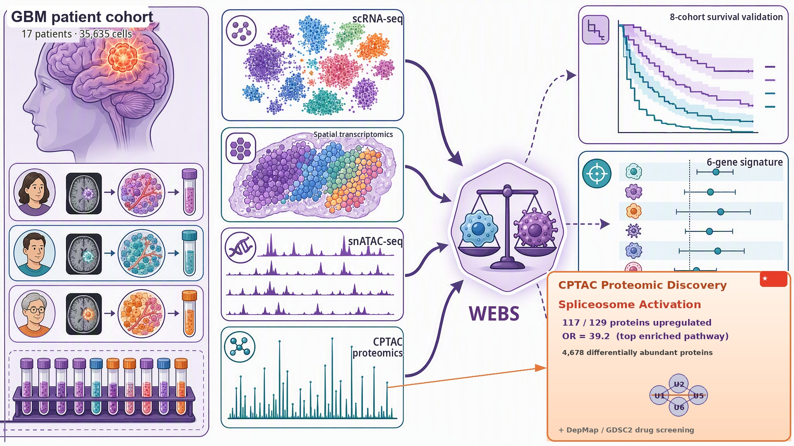

```{=openxml}
<w:p><w:r><w:br w:type="page"/></w:r></w:p>
```
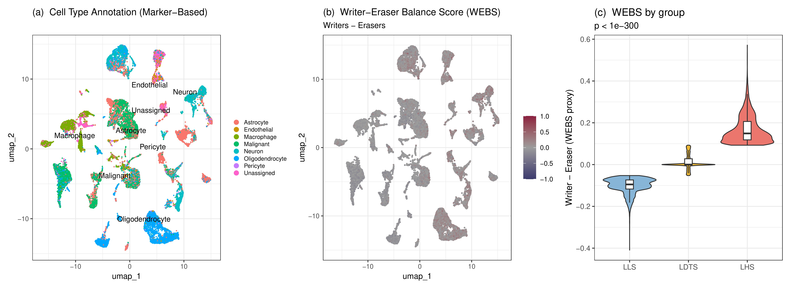

```{=openxml}
<w:p><w:r><w:br w:type="page"/></w:r></w:p>
```
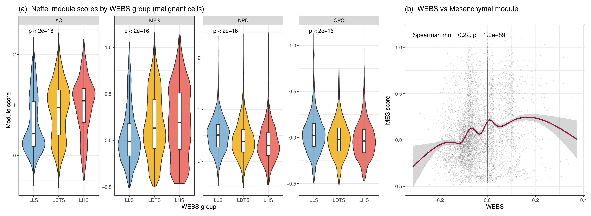

```{=openxml}
<w:p><w:r><w:br w:type="page"/></w:r></w:p>
```
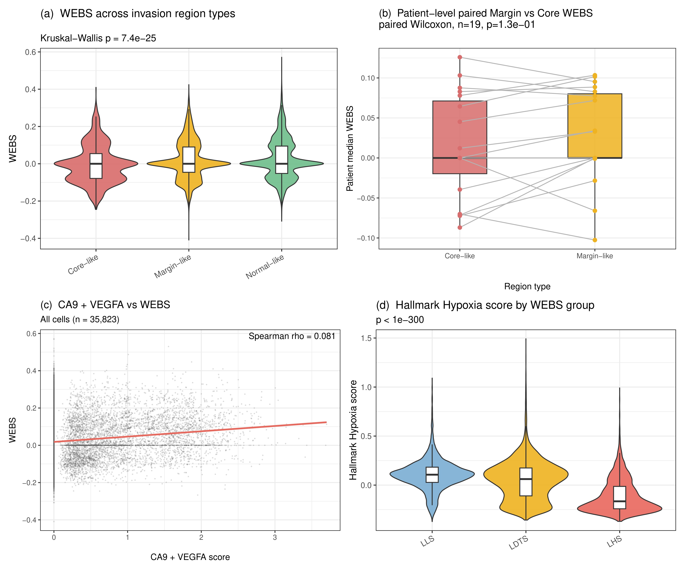

```{=openxml}
<w:p><w:r><w:br w:type="page"/></w:r></w:p>
```
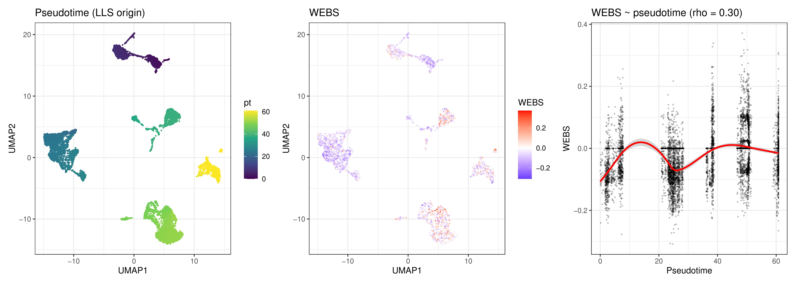

```{=openxml}
<w:p><w:r><w:br w:type="page"/></w:r></w:p>
```
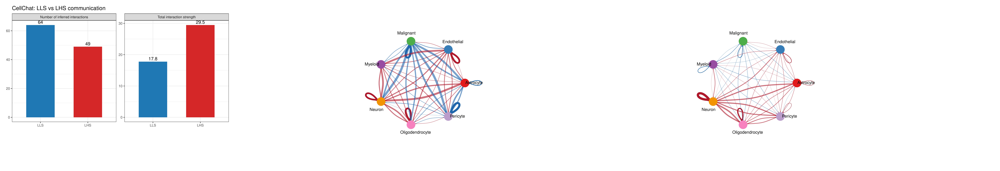

```{=openxml}
<w:p><w:r><w:br w:type="page"/></w:r></w:p>
```
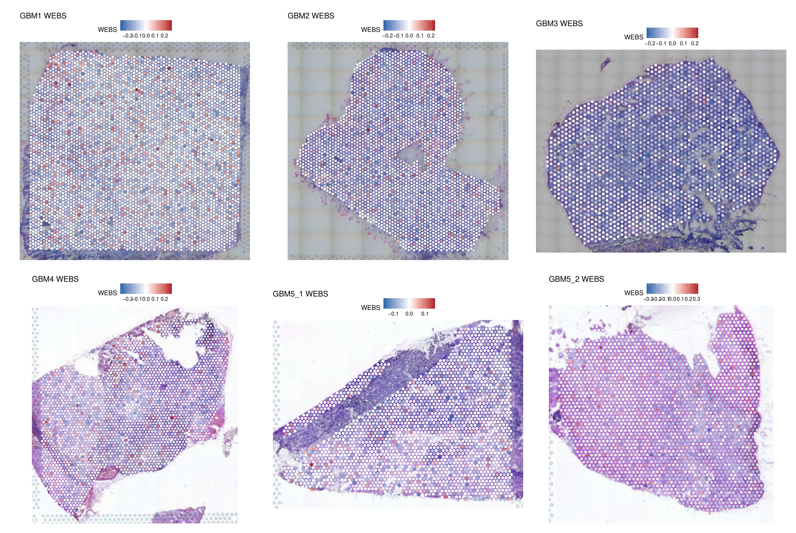

```{=openxml}
<w:p><w:r><w:br w:type="page"/></w:r></w:p>
```
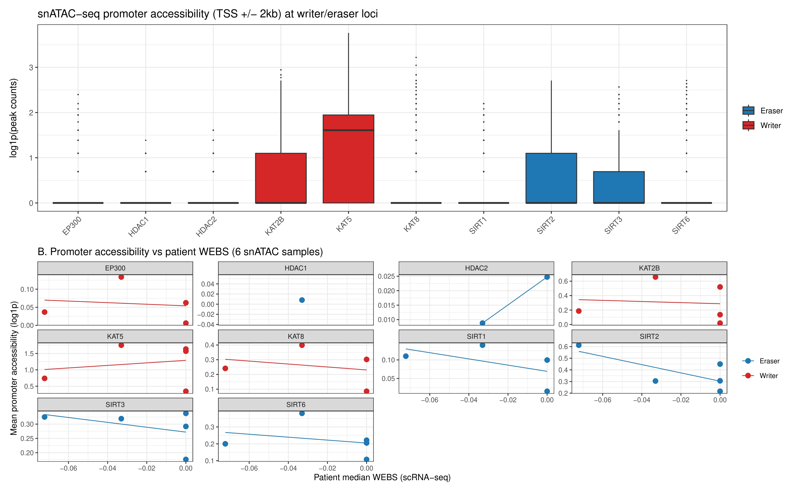

```{=openxml}
<w:p><w:r><w:br w:type="page"/></w:r></w:p>
```
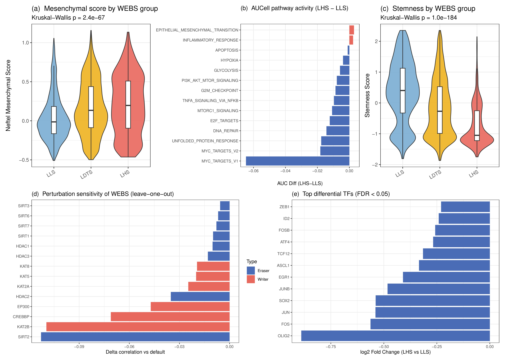

```{=openxml}
<w:p><w:r><w:br w:type="page"/></w:r></w:p>
```
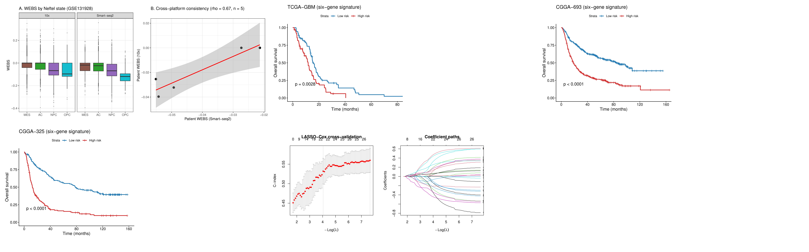

```{=openxml}
<w:p><w:r><w:br w:type="page"/></w:r></w:p>
```
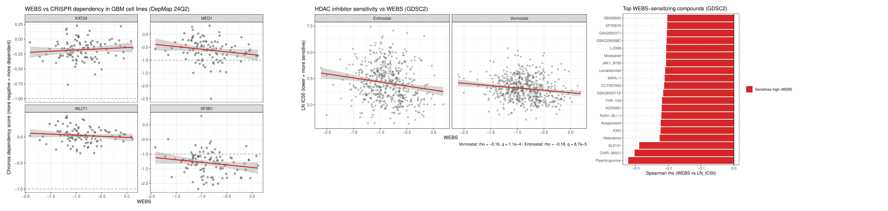

```{=openxml}
<w:p><w:r><w:br w:type="page"/></w:r></w:p>
```
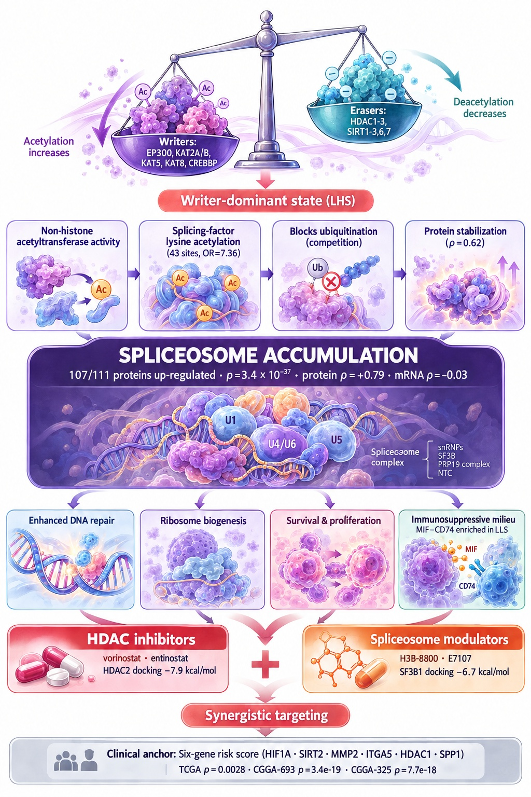

