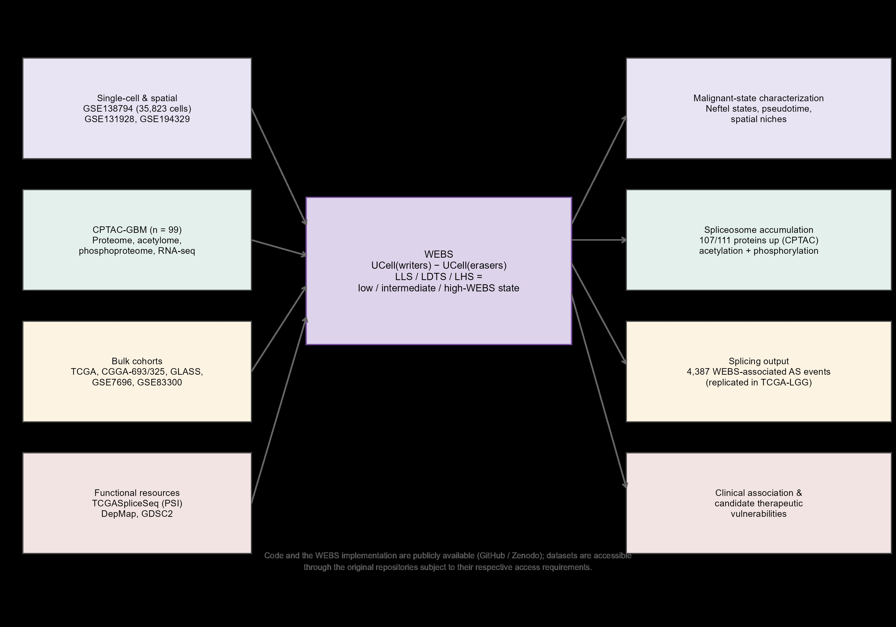
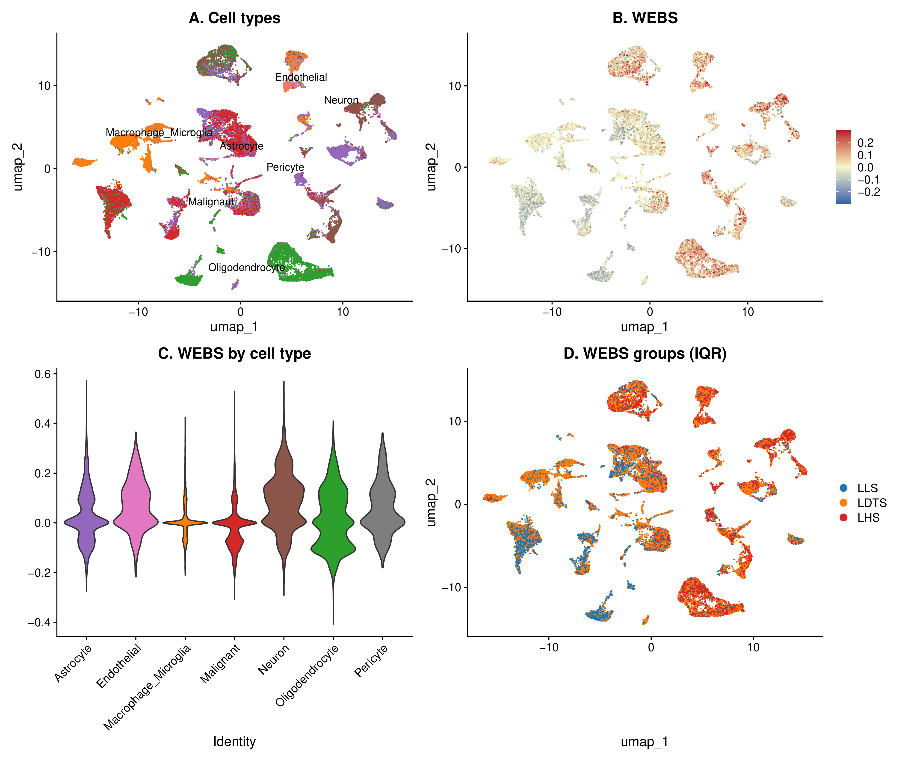
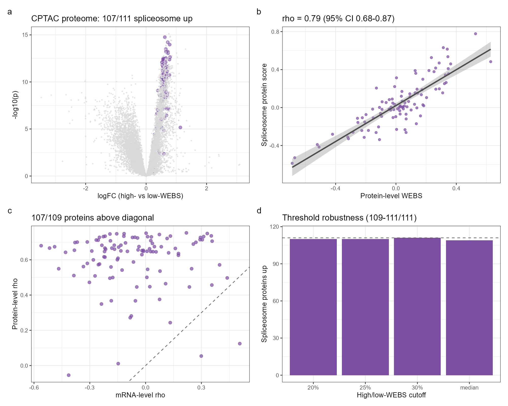
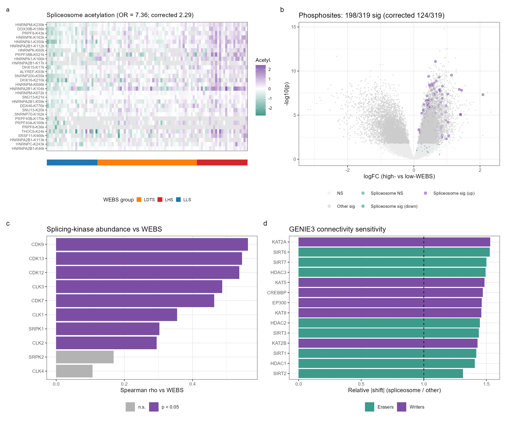
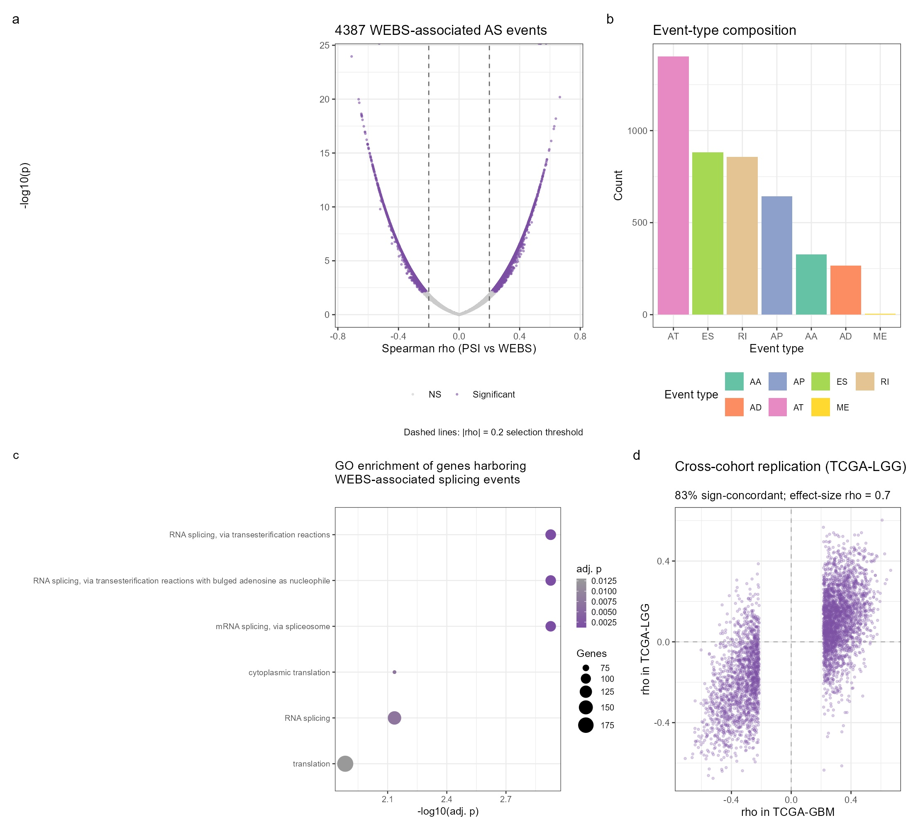
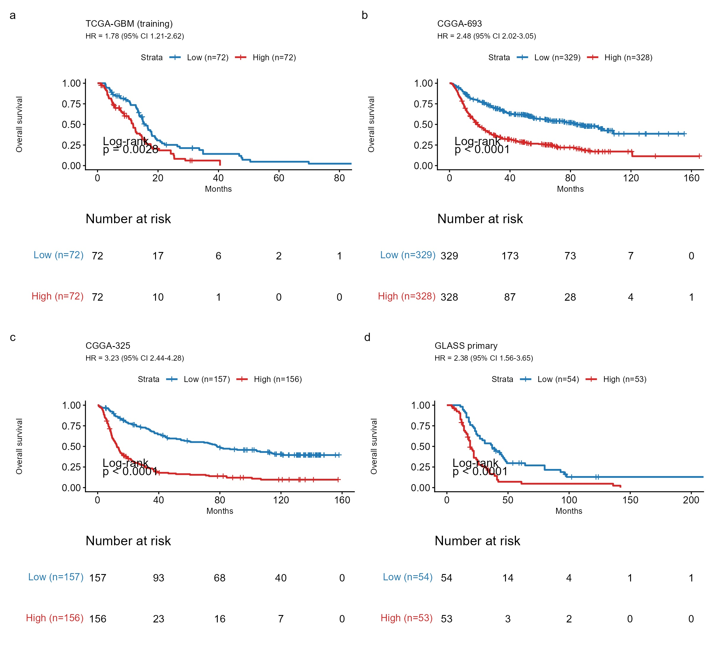
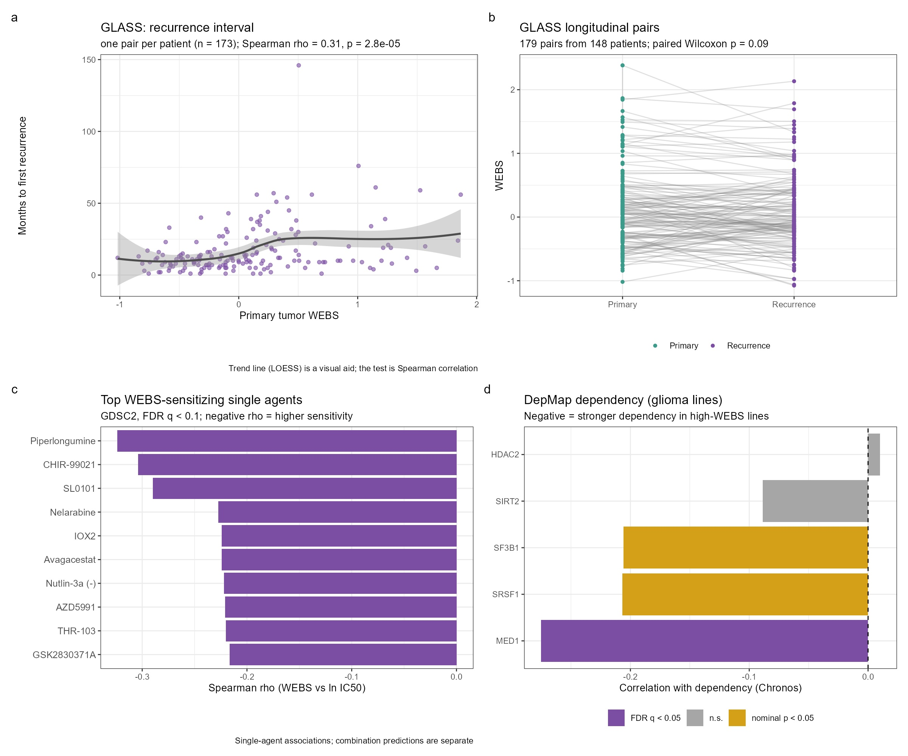

# Title Page

**Title**: A writer-dominant expression state is associated with post-transcriptional spliceosome accumulation in glioblastoma

**Authors**: Jia Chen¹*, Junhan Yang²#, Bing Yang³#, Tianyi Zhou⁴#, Peijun Zhao¹

**Affiliations**:
¹ Department of Bioinformatics, Chengdu Neusoft University, Chengdu, China
² Xinjiang Medical University, Urumqi, China
³ North Sichuan Medical College, Nanchong, China
⁴ Chongqing University, Chongqing, China

# These authors contributed equally to this work.
\* Corresponding author: Jia Chen, Department of Bioinformatics, Chengdu Neusoft University, Chengdu, China. Email: 1176625889@qq.com

**Running title**: Spliceosome accumulation in GBM

---

# Abstract

**Background**: Transcript- and protein-level studies of the spliceosome yield contradictory prognostic signals in glioma. We asked whether glioblastoma (GBM) harbors a state marked by post-transcriptional spliceosome accumulation. **Methods**: We integrated single-cell (35,823 cells), spatial, and bulk transcriptomics with CPTAC proteomics, acetylomics, and phosphoproteomics, defining an expression-based Writer–Eraser Balance Score (WEBS). **Results**: A writer-dominant state showed proteome-wide spliceosome accumulation (107/111 proteins significantly up-regulated) that tracked WEBS at the protein (ρ = 0.79, 95% CI 0.68–0.87) but not the mRNA level (ρ = −0.03), although discordance magnitude was not spliceosome-specific under expression-matched permutation (p = 0.22). Spliceosome acetylation was enriched (parent-protein-corrected OR = 2.29), phosphosite signal changed in an abundance-dependent manner, and 4,387 alternative splicing events tracked WEBS, replicating in TCGA-LGG (83% sign-concordant). A six-gene signature was externally validated in three glioma cohorts (GLASS HR = 2.14, p = 2.0 × 10⁻⁶; C-index 0.62–0.67). Candidate vulnerabilities (MED1, SF3B1, HDAC2, SIRT2) were nominated computationally. **Conclusions**: A writer-dominant expression state is associated with post-transcriptional spliceosome accumulation, coordinated post-translational modification, and altered splicing output in GBM, nominating candidate vulnerabilities for experimental testing.

(196 words)

**Keywords**: alternative splicing; epigenetic writer–eraser balance; glioblastoma; post-transcriptional regulation; spliceosome

---

# Highlights

- Writer-dominant expression is associated with spliceosome protein accumulation in GBM
- Accumulation is accompanied by altered acetylation and phosphorylation patterns
- 4,387 WEBS-associated splicing events replicate in TCGA-LGG (83% sign-concordant)
- Six-gene signature validated in three independent cohorts; moderate discrimination
- Computational evidence nominates candidate spliceosome/HDAC vulnerabilities

---

# Abbreviations

AC, astrocyte-like; AS, alternative splicing; AUCell, area under the curve cell scoring; CNV, copy-number variation; CPTAC, Clinical Proteomic Tumor Analysis Consortium; FDR, false discovery rate; GBM, glioblastoma; GLASS, Glioma Longitudinal Analysis Consortium; GRN, gene-regulatory network; HDAC, histone deacetylase; ICB, immune checkpoint blockade; LDTS, intermediate-WEBS state; LHS, high-WEBS state; LLS, low-WEBS state; MES, mesenchymal; MOFA2, multi-omics factor analysis 2; NPC, neural-progenitor-like; OPC, oligodendrocyte-progenitor-like; PSI, percent spliced in; RCTD, robust cell-type decomposition; SHAP, SHapley additive explanations; snATAC-seq, single-nucleus ATAC sequencing; TCGA, The Cancer Genome Atlas; TMT, tandem mass tag; UCell, rank-based single-cell signature scoring; WEBS, Writer–Eraser Balance Score.

---

# 1. Introduction

Glioblastoma (GBM) remains the most aggressive primary brain tumor in adults, with a median overall survival of approximately 15 months despite maximal resection, radiochemotherapy, and temozolomide [1,2]. Intratumoral heterogeneity spans genomic, transcriptomic, epigenetic, and metabolic layers [3,4], and therapeutic resistance emerges from this heterogeneity. Spliceosomal dysregulation is a recognized hallmark of cancer [33], and the SF3B1 modulator H3B-8800 has reached phase-I testing in myeloid neoplasms [34], and pladienolide-class compounds such as E7107 have been evaluated preclinically, while preclinical studies suggest that selected SF3B1-mutant tumors may exhibit increased sensitivity to spliceosome inhibition [35]; their role in GBM remains incompletely characterized [35,36]. Notably, reports on splicing machinery and prognosis in glioma are contradictory: transcript-level measurements associate spliceosome expression weakly or even favorably with outcome, whereas proteomic studies imply the opposite. We reasoned that this contradiction might arise from a layer-specific phenomenon — post-transcriptional accumulation of splicing machinery that transcript-level measurements may not fully capture.

What upstream program could drive such layer-specific accumulation? Histone acylation — including acetylation and lactylation of histone tails — is written by histone acetyltransferases (EP300, KAT2A, KAT2B, KAT5, KAT8, CREBBP) and erased by class I HDACs and sirtuins (HDAC1–3, SIRT1–3, SIRT6–7) [5,10–12], and the net modification state reflects the balance between these opposing enzymatic capacities. Histone acylation is disease-relevant in glioma [6–9,13–15], and several lactylation-associated prognostic signatures have been derived [27–32], but these remain at the transcriptomic correlation level. Importantly, the same enzymes also catalyze non-histone protein acetylation, including of splicing factors — a regulatory layer distinct from chromatin-level histone modification. We therefore hypothesized that writer–eraser imbalance could stabilize the spliceosome at the protein level without altering its transcription — a mechanism that may not be fully captured by transcriptomic measurements.

We therefore asked three questions: (i) Does a discrete writer–eraser imbalance state exist within GBM tumors? (ii) What is its proteomic output, is the accumulated machinery functionally active, and can it explain the transcript–protein contradiction? (iii) Is it therapeutically actionable, and where do its predictions stop? We introduce the Writer–Eraser Balance Score (WEBS), a rank-based transcriptomic score computable on single-cell and bulk data. WEBS is designed as an expression-based proxy of the relative abundance of selected acylation-associated writers and erasers, not as a direct measure of enzymatic activity or of site-specific lysine acylation. Evidence for a malignant-cell-intrinsic state derives primarily from single-cell transcriptomics, whereas spliceosome accumulation is demonstrated at the bulk-proteome level; these layers are reported separately throughout. We subject the score to multi-layer validation: single-cell and spatial transcriptomics, snATAC-seq, CPTAC TMT proteomics, acetylomics and phosphoproteomics, transcriptome-wide alternative splicing analysis, bulk clinical cohorts including the longitudinal GLASS consortium, in-silico network perturbation, CRISPR dependency screens, pharmacogenomic screens, molecular docking, pan-cancer analysis across 33 TCGA cohorts, and method-level benchmarking. Negative and boundary results are reported explicitly. An overview of the study design is shown in Fig. 1.

# 2. Methods

## 2.1 Data sources

scRNA-seq: GSE138794 (35,823 QC-passed cells, 20 samples, 17 patients). Spatial: GSE194329 (six GBM Visium slices). External scRNA: GSE131928 (Smart-seq2 and 10x). Bulk: TCGA-GBM (LinkedOmics legacy, n = 144; GDC STAR-counts, n = 371), CGGA-693, CGGA-325, GSE7696, GSE83300 (n = 50); RPPA: TCPA RPPA500 (n = 71 matched). Longitudinal: GLASS consortium RNA-seq (gene-level TPM, 425 aliquots; 403 mapped to cases; 107 primary tumors with survival; 179 primary–recurrence pairs from 148 patients; 213 recurrence-interval records from 173 patients) accessed via Synapse (syn17038081) [38]. Proteomics: CPTAC-GBM TMT proteome [24] (11,141 proteins), acetylome (13,556 sites), phosphoproteome (31,010 quantified sites), and RNA-seq (n = 99). Alternative splicing: TCGASpliceSeq percent-spliced-in (PSI) values for TCGA-GBM (28,071 events, 153 samples matched to WEBS) [39]. Pharmacogenomics: DepMap 24Q2 [25] (CRISPRGeneEffect, expression, model metadata) and GDSC2 [26] (fitted dose responses). Pan-cancer: all 33 TCGA cohorts (STAR-TPM and survival, UCSC Xena GDC hub). All cohorts are summarized in Table 1.

## 2.2 WEBS computation

Writers: EP300, KAT2A, KAT2B, KAT5, KAT8, CREBBP. Erasers: HDAC1, HDAC2, HDAC3, SIRT1, SIRT2, SIRT3, SIRT6, SIRT7. Single-cell WEBS = UCell(writer) − UCell(eraser), with maxRank fixed at 1,500 (approximately 7.5% of the ~20,000-gene universe). Parameter sensitivity was evaluated across maxRank values defined as 5%–90% of the full gene universe (i.e., 1,000–18,000), using the same gene sets and scoring procedure (Fig. S2); scores were stable up to ~10% of genes (ρ ≥ 0.95 vs the default). Bulk WEBS = mean log2(writer + 1) − mean log2(eraser + 1). Protein WEBS = mean(writer) − mean(eraser) over all writer/eraser proteins quantified in the TMT panel (10 writer-class and 16 eraser-class proteins, full list in Supplementary Table S_protein_WEBS; the panel differs from the 6/8 gene-level sets because TMT detection is incomplete; no imputation was applied). As a robustness check, a per-protein z-scored variant of protein WEBS (z-score of each protein across samples before averaging) correlated with the default at ρ = 0.95. IQR stratification: bottom 25% low-WEBS state (LLS), middle 50% intermediate-WEBS state (LDTS), top 25% high-WEBS state (LHS). Note that WEBS is an expression-level score of writer/eraser balance; the state labels do not imply direct measurement of any specific lysine acylation or of enzymatic activity.

## 2.3 Single-cell analysis

Seurat v5 pipeline [16] (log-normalization, 2,000 variable features, PCA dims 1:30, UMAP, resolution 0.8). Cell identities were anchored to the original study's annotations and cross-checked by marker-based scoring. CopyKAT (per-sample, ≤1,200 cells, hg19) distinguished aneuploid tumor cells. Region types: Core (MKI67, TOP2A, PCNA), Margin (FN1, ITGA5, SPP1, MMP2), Normal (RBFOX3, MAP2, GFAP) composite max-score assignment. Hypoxia decoupling: logistic regression (Margin ~ WEBS + Hallmark Hypoxia) and partial correlation. Trajectory: Slingshot [18] on neoplastic cells with LLS origin; GAM fit of WEBS along pseudotime. Spliced/unspliced matrices are not deposited for GSE138794, precluding RNA velocity. Pseudoreplication control: key single-cell associations were re-tested with patient as the statistical unit — patient × state pseudobulk means, linear mixed-effects models with patient as random intercept (lme4/lmerTest), and per-patient Spearman correlations with one-sample tests (Fig. S21).

## 2.4 Spatial transcriptomics

SCTransform per slice; RCTD was attempted [19] but its internal caching step failed on our platform, so label-transfer-free spot-level WEBS was used; spot-level WEBS on SCT-normalized data; dual-hotspots defined at the 75th percentile of writer and metabolism scores; Moran's I and Geary's c with six-nearest-neighbor weights and 1,000 label permutations (spdep).

## 2.5 snATAC-seq

snATAC-seq libraries from the same study (GSE138794; six libraries: GSM4119513–GSM4119518, corresponding to tumors SF11964, SF12017, SF11949, SF11612, SF11979, SF11956) were analyzed. Per GEO annotation, these comprise two IDH-wild-type GBM, two IDH-mutant astrocytomas, and two oligodendrogliomas (one recurrent); the analysis is therefore an exploratory mixed-histology glioma analysis, not GBM-specific. Fragment files were not deposited; analysis was performed at peak-matrix level with the Signac workflow [20]. Peaks are GRCh38 (verified by TSS-overlap test: 21.7% of sampled peaks overlap hg38 TSS±2 kb vs 12.0% for hg19); promoter accessibility was aggregated over peaks within TSS ± 2 kb of writer/eraser genes (EnsDb.Hsapiens.v86), and per-sample mean accessibility was correlated with patient-median scRNA WEBS.

## 2.6 Proteomics, acetylomics, and phosphoproteomics

limma differential abundance (LHS vs LLS) on the CPTAC TMT proteome; spliceosome enrichment by Fisher's exact test (111 spliceosome proteins passing detection filtering out of the curated list). Layer discordance: protein WEBS vs protein pathway score, and mRNA WEBS vs mRNA pathway score (Spearman), with patient-paired bootstrap 95% CIs (2,000 resamples of patients, RNA and protein drawn jointly per patient), leave-one-protein-out analysis, partial correlations controlling proliferation/immune/mesenchymal/hypoxia/OPC protein programs, and specificity against 10,000 random gene sets matched for proteome abundance (empirical p). Acetylome: 13,556 measured sites were filtered to 8,350 sites quantified in ≥50% of samples for limma testing; enrichment of spliceosome sites among hyper-acetylated sites; per-protein acetylation–abundance coupling; site-level ordered trend across LLS/LDTS/LHS (Jonckheere trend test). Phosphoproteome: per-site limma (LHS vs LLS; sites quantified in ≥50% of samples); Fisher enrichment of spliceosome-protein phosphosites among significant sites; SRSF-family phosphosites examined separately; kinase abundance (SRPK1/2, CLK1–4, CDK7/9/12/13) correlated with WEBS (Spearman). To separate occupancy-level from abundance-level changes, PTM analyses were repeated on abundance-corrected site values (site intensity − parent-protein abundance, log scale). Histone acetylation: mean across histone H1/H2A/H2B/H3/H4 sites.

## 2.7 Alternative splicing analysis

TCGASpliceSeq PSI values (all seven event types: ES, RI, AP, AT, AA, AD, ME; ≥75% samples with values) were correlated with bulk WEBS per event (Spearman, n = 153 samples), Benjamini–Hochberg corrected; events with q < 0.05 and |ρ| > 0.2 were considered WEBS-associated. Genes harboring WEBS-associated events were tested for GO biological-process enrichment (clusterProfiler, tested genes as background). To control for cell-type composition confounding in bulk data, all WEBS-associated events were re-tested by Spearman partial correlation controlling for an immune-marker score (ppcor).

## 2.8 Multi-omics integration

MOFA2: four-view integration (proteome, acetylome, phosphoproteome, RNA-seq; top 3,000 variable features per view; 10 factors, seed 42) using mofapy2; factor–WEBS Spearman correlations with BH correction. Similarity network fusion (SNFtool; K = 20 neighbors, t = 20 iterations): proteome, acetylome, and transcriptome patient-level matrices were fused into a consensus network and clustered; cluster–WEBS association was tested by Kruskal–Wallis. WGCNA: signed co-expression network on the CPTAC proteome (soft-thresholding power selected by scale-free fit, minimum module size 30, dynamic tree cut); module eigengenes were correlated with WEBS (Pearson, BH-corrected). STRING v12: the spliceosome protein panel was queried with default confidence (0.4) and full-network evidence; edge enrichment was evaluated against the expected edges for a random node set of equal size, and hub nodes were ranked by degree.

## 2.9 Connectivity-based network sensitivity analysis

A GENIE3-based gene-regulatory network was inferred from malignant-cell expression data [40]. Because GENIE3 provides unsigned importance weights, perturbation analysis was interpreted as a connectivity-based sensitivity analysis rather than a directional gene-knockout simulation. For each regulator, a unit perturbation magnitude was propagated through the normalized adjacency matrix over one and two steps (the second step weighted by 0.5). The mean absolute predicted shift was calculated separately for spliceosome genes and other target genes, and the relative sensitivity was compared between the two groups.

## 2.10 Prognostic modeling and longitudinal analysis

LASSO-Cox [21] (glmnet, 10-fold CV, lambda.min rule, standardized continuous predictors) on 29 pre-specified lactylation/hypoxia/invasion candidate genes was trained in the TCGA-GBM LinkedOmics cohort (n = 144) and yielded the six-gene signature (HIF1A, SIRT2, MMP2, ITGA5, HDAC1, SPP1); coefficients were locked after cross-validation within a Cox proportional-hazards framework [22]. The candidate pool was defined a priori and not re-selected within folds; nested cross-validation was not performed, which we note as a limitation. Its performance was evaluated in three independent external cohorts (CGGA-693, CGGA-325, and GLASS). GSE7696 and GSE83300 were analyzed as additional external cohorts, in which effect directions were concordant but statistical significance was not reached. IDH-wild-type analyses were performed as subgroup analyses within the CGGA cohorts and were not considered independent validation. The TCGA-GBM GDC dataset was used only for boundary assessment because all 144 training patients were also present in this dataset; accordingly, it was not treated as an independent validation cohort. CPTAC was not used for survival validation of the signature because the available clinical annotation lacks survival fields. Risk scores were computed from log2-normalized expression with the fixed coefficients in every cohort — no cohort-specific re-standardization, gene reselection, or coefficient refitting was performed. Risk scores were dichotomized at the cohort-specific median (relative within-cohort stratification, not a fixed transferable cutoff). Bootstrap (1,000× resamples of the full candidate-selection pipeline) selection frequencies; SHAP (kernelshap) on the Cox linear predictor (background = training distribution); RPPA lactate-metabolism score (mean of LDHA, LDHB, PKM2, MCT4, HIF1A, ENO1, ENO2, GAPDH antibody intensities, log2, n = 71 matched samples). GLASS longitudinal analysis: primary–recurrence pairs (RNA aliquots with both time points quantified; n = 179 pairs from 148 patients) were compared by paired tests; the recurrence-interval analysis used all longitudinal records with a recorded positive surgical interval (n = 213 records from 173 patients), with a first-record-per-patient sensitivity analysis (n = 173).

## 2.11 Pharmacogenomics, combination prioritization, and molecular docking

DepMap: Spearman correlation of WEBS with Chronos dependency in 102 glioma lines (IDH-wild-type GBM subset n = 84); more negative Chronos scores indicate stronger dependency. GDSC2: WEBS vs LN_IC50 across 286 compounds in all cell lines with available DepMap expression (pan-cancer; 2,130 lines; per-drug analyses required ≥30 lines, median n = 542, range 112–1,050); HDAC inhibitors specifically. Results therefore represent pan-cancer cell-line pharmacogenomic associations, not glioma-restricted sensitivity. Combination prioritization: a Bliss-expected response was computed from single-agent dose responses (additive model ea + eb − ea·eb) for selected drug pairs and correlated with WEBS — this is a computational prioritization from single-agent data, not a measured synergy experiment. Docking: AutoDock Vina 1.2.7; receptors 4LXZ (HDAC2), 5D7P (SIRT2), 6EN4 (SF3b complex); boxes centered on co-crystallized ligands (SAHA, EX-243, macrolide BGZ); exhaustiveness 16; docking scores are computational estimates, not measured binding affinities.

## 2.12 Communication analysis and benchmarking

CellChat v2 (human database, triMean) on LLS and LHS compartments with unified cell-type labels; pathway-level information-flow comparison; MIF axis tested as mean ligand (myeloid) × mean receptor (malignant) with 10,000 label permutations. Method benchmarking on GSE131928 patient-level scores (WEBS, AUCell, ssGSEA, PLAGE, all-gene mean). Computational performance measured at 1k/5k/10k/25k/35.8k cells.

## 2.13 Pan-cancer analysis

All 33 TCGA cohorts from the UCSC Xena GDC hub (STAR-TPM, Ensembl IDs mapped to symbols via org.Hs.eg.db). Primary tumors only (sample type 01; LAML/DLBC/THYM unfiltered as they lack solid-tumor type codes). Per cohort: Spearman correlation of WEBS with the spliceosome pathway score (mean log-TPM of the 111-gene panel), with Benjamini–Hochberg correction across all 33 tests; and univariate Cox regression of the six-gene signature (fixed coefficients) on overall survival in cohorts with ≥30 samples and ≥5 events (reported without covariate adjustment; BH correction applied across cohorts). Per-cohort sample sizes and event counts are provided in Supplementary Table S_pancancer33.

## 2.14 Statistics and reproducibility

All tests two-sided; Benjamini–Hochberg FDR where applicable. R 4.5.2; full pipeline (50+ scripts) and the WEBS standalone implementation are available in the project repository. Core analyses were re-executed from raw data on an independent machine; the run log and a file-by-file numeric comparison are provided in the repository (run_verification_battery.R, compare_rerun.py).

# 3. Results

## 3.1 WEBS defines a continuous writer–eraser balance axis across GBM cell states

We assembled 35,823 cells passing quality control from 20 tumor samples of 17 GBM patients (GSE138794); CopyKAT-purified malignant cells (used for trajectory, region, and pseudobulk analyses) derived from 8 of these patients. WEBS varied continuously across cells and differed between Neftel malignant states in both the discovery cohort and an external cohort (GSE131928; Smart-seq2: Kruskal–Wallis p = 1.6 × 10⁻¹⁶⁸; 10x: p = 1.0 × 10⁻³¹³), with OPC-like cells lowest (Fig. 2, Fig. S25; external-cohort panels in Fig. S24). Copy-number-based tumor purification (CopyKAT; 16,255 cells called) confirmed that stratification is preserved within 4,421 aneuploid cells at the cell level (p < 10⁻¹⁶), excluding normal-cell admixture as an explanation (Fig. S1); note that this cell-level statistic does not by itself establish patient-level significance, which is addressed separately below. To guard against pseudoreplication (cells from the same patient are not independent replicates), all key single-cell associations were re-tested with patient as the statistical unit: the Neftel-state gradient remained significant under pseudobulk mixed-effects modeling (p = 7.4 × 10⁻⁴), and the within-malignant-cell hypoxia decoupling was confirmed per-patient (median ρ = −0.02, one-sample Wilcoxon p = 1), whereas the regional gradient and the pseudotime trend attenuated at patient level (p = 0.77 and p = 0.22, respectively) and are therefore presented as supportive cell-level observations (Fig. S21).

## 3.2 The axis is regionally organized but decoupled from canonical hypoxia

WEBS differed across Core-like, Margin-like, and Normal-like regions when all cells were considered (Kruskal–Wallis p < 2.2 × 10⁻¹⁶; Fig. S26a), and a patient-level Margin-vs-Core paired test on all cells confirmed the regional gradient (paired Wilcoxon, n = 17; S26b). However, within CopyKAT-purified malignant cells the regional gradient attenuated at the patient level (pseudobulk mixed-effects p = 0.77; only 3 patients contributed both Margin-like and Core-like malignant cells), so the regional association is reported as a whole-tumor-compartment observation rather than a malignant-cell-intrinsic one. Although WEBS correlated with the Hallmark Hypoxia signature across all cells, this association was driven by non-malignant compartments: within malignant cells WEBS was essentially decoupled from hypoxia (ρ = −0.054; confirmed per-patient, median ρ = −0.02, one-sample Wilcoxon p = 1), and the Margin association persisted after hypoxia adjustment (logistic regression p = 3.8 × 10⁻⁴; Fig. S26c,d).

## 3.3 Cell-level pseudotime is consistent with continuous WEBS-associated variation

Slingshot pseudotime on 7,952 neoplastic cells (LLS origin) placed WEBS along a transcriptional continuum (GAM p < 10⁻¹⁶; Spearman ρ = 0.301, p = 2.7 × 10⁻¹⁶⁶; Fig. S27). Because the LLS origin is an analytical convention and the trend attenuated at the patient level (per-patient median ρ = 0.09, p = 0.22), we interpret this as supportive evidence for a continuous axis of state-associated variation rather than proof of a directional LLS→LDTS→LHS transition.

## 3.4 Proteome-wide spliceosome accumulation tracks the writer–eraser balance at the protein but not the mRNA level

Protein-level WEBS stratified 99 CPTAC-GBM tumors. Differential abundance (limma, LHS vs LLS) revealed 107 of 111 quantified spliceosome proteins significantly up-regulated in LHS (FDR < 0.05) with none significantly down-regulated (enrichment p = 3.4 × 10⁻³⁷); notably, 110 of the 111 proteins showed positive log fold-changes, indicating a broadly shifted abundance pattern across the complex (Fig. 3). The direction-uniform up-regulation was robust to stratification threshold (109–111/111 across 20%/25%/30% quantile cutoffs and median split; Supplementary Table S_threshold_sensitivity). Spliceosome abundance tracked protein-level WEBS (ρ = 0.79, 95% bootstrap CI 0.68–0.87) but not mRNA-level WEBS (ρ = −0.03, 95% CI −0.22 to 0.18); the layer discordance (Δρ = 0.81) was formally significant (bootstrap 95% CI 0.60–1.03, p < 0.0001), was not driven by any single protein (leave-one-protein-out ρ range 0.788–0.795), held at the per-gene level (107/109 genes showed stronger protein- than mRNA-layer correlation; Fig. S22), and persisted after controlling for proliferation and immune-content protein scores (partial ρ = 0.65, p = 9.7 × 10⁻¹³) as well as mesenchymal, hypoxia, and OPC-like programs (joint partial ρ = 0.66, p = 5.8 × 10⁻¹³). Notably, an expression-matched permutation control (10,000 random gene sets matched for proteome abundance) showed that partial protein–mRNA discordance is a generic property of abundant protein complexes (spliceosome empirical p = 0.22 by this stricter criterion; Fig. S7); the spliceosome-specific claims in this study therefore rest on the uniform direction of regulation (107/111), its enrichment statistics, and the functional layers below, rather than on discordance magnitude alone. Protein WEBS also correlated with overall histone acetylation (r = 0.62, p = 5.3 × 10⁻¹²).

## 3.5 Mechanistic evidence: splicing-factor acetylation couples to protein abundance

Among 8,350 tested acetylation sites, 786 were hyper-acetylated in LHS, with spliceosome-protein sites strongly enriched (43 hyper-acetylated of 102 quantified spliceosome sites; Fisher OR = 7.36, p = 1.3 × 10⁻¹⁸). Because peptide-level PTM signal can simply track parent-protein abundance, we re-ran the analysis on abundance-corrected site values (site − parent protein, log scale): the spliceosome enrichment was attenuated but remained significant (OR = 2.29, p = 0.003; Fig. 4a), indicating an abundance-adjusted acetylation component beyond changes in parent-protein abundance, while also implying that part of the raw signal reflects the accumulation itself. Per-site acetylation correlated with WEBS for 52 of 88 quantified spliceosome sites (FDR < 0.05; median ρ = 0.56), and all 43 hyper-acetylated spliceosome sites showed a monotonic increasing trend across the LLS, LDTS, and LHS groups (Jonckheere trend), supporting an ordered association with the WEBS-defined state. These 43 sites were selected from the same differential analysis, so the trend constitutes consistency evidence rather than independent validation. Peak-level snATAC-seq analysis of writer/eraser promoter accessibility (six mixed-histology glioma libraries) detected no consistent association with patient-median WEBS; only CREBBP showed a nominal negative correlation (r = −0.89, p = 0.04), which did not survive multiple-testing correction (Fig. S30); this provides no evidence for a chromatin-accessibility-driven basis of the axis, although the analysis is limited by sample size and histologic heterogeneity. Per-protein acetylation was associated with protein abundance (median ρ = 0.62; PRPF40B 0.87, HNRNPA2B1 0.85, PRPF8 0.84; Fig. S8). The spliceosome proteins form a physical interaction network far denser than chance expectation (STRING: 3,349 edges among 121 nodes, network enrichment p < 10⁻⁶⁴; hubs SNW1, SRSF1, SF3B1; Fig. S18), consistent with complex-level co-regulation. The absence of a global proteasome-impairment signature argues against generalized suppression of proteasomal activity as an explanation for spliceosome accumulation; however, these observational data cannot establish whether site-specific acetylation alters the turnover of individual spliceosome proteins. Consistent with this profile, malignant-cell functional characterization (Hallmark pathway activity, CytoTRACE-like stemness, perturbation sensitivity, and differential transcription factors with OLIG2 top-ranked) is summarized in Fig. S31.

## 3.6 The accumulated spliceosome shows signatures of functional engagement

Accumulation of an enzymatic machine does not itself imply altered activity, so we tested the functional output directly. Transcriptome-wide alternative splicing analysis (TCGASpliceSeq PSI values, TCGA-GBM) identified 4,387 of 28,071 events (15.6%) significantly associated with bulk WEBS (q < 0.05, |ρ| > 0.2; median |ρ| = 0.30; Fig. 5a,b). Genes harboring WEBS-associated events were enriched for RNA splicing and mRNA processing themselves (GO:0000375, adjusted p = 1.2 × 10⁻³, 106 genes; Fig. 5c), i.e., enrichment of RNA-processing and splicing-related genes among genes harboring WEBS-associated events. Because bulk PSI values could reflect shifts in cell-type composition rather than malignant-cell splicing, we re-tested all WEBS-associated events by partial correlation controlling for an immune-marker score (PTPRC, CD68, CD163, CD14, CD3D/E, CD8A, MS4A1, NCAM1, FOXP3): 91% of events (3,987/4,387) retained significance (median |ρ| 0.30 → 0.29), indicating that the association was not fully explained by the immune-marker score used in the partial-correlation analysis. Furthermore, the events replicated cross-cohort: in TCGA-LGG (TCGASpliceSeq), 4,285 of the GBM events were testable, 83% were sign-concordant (binomial p < 10⁻¹⁶), 69% remained significant (q < 0.05), and effect sizes correlated strongly across cohorts (ρ = 0.70; Fig. 5d).

Independently, the CPTAC phosphoproteome showed that spliceosome proteins carry more phosphosite signal in LHS: 198 of 319 quantified spliceosome phosphosites differed between LHS and LLS (FDR < 0.05; 197 of 198 increased; Fisher enrichment OR = 3.26, p = 3.0 × 10⁻²⁵). However, after correcting each site for parent-protein abundance, 118 of the 124 remaining significant sites decreased, indicating that the raw signal is largely driven by increased protein abundance, while the abundance-adjusted phosphosite signal (a relative occupancy proxy) of the accumulated complex is reduced (including SR-protein RS domains: 27 of 28 significant SRSF sites decreased after correction; Fig. 4b). Abundance of the splicing kinases themselves tracked WEBS (CLK3 ρ = 0.49, p = 1.5 × 10⁻⁶; CDK9 ρ = 0.56, p = 2.1 × 10⁻⁹; CDK12 ρ = 0.54; CDK13 ρ = 0.55; SRPK1 ρ = 0.30, p = 0.002; Fig. 4c). Thus the accumulated machinery is more abundant and accompanied by higher abundance of selected splicing kinases, but is not simply "hyper-phosphorylated"; its phosphorylation stoichiometry is altered in a site- and layer-dependent manner.

Finally, in-silico perturbation of a malignant-cell gene-regulatory network (GENIE3, unsigned weights) showed that spliceosome genes were more sensitive in absolute predicted shift than other genes for every one of the 14 writer/eraser regulators (per-regulator sensitivity ratios 1.31–1.53; one-sample Wilcoxon across regulators p = 6.1 × 10⁻⁵; Fig. 4d), indicating that the spliceosome program is disproportionately wired to acetylation-regulatory input; because GENIE3 weights are unsigned, this connectivity-based sensitivity analysis reflects network wiring rather than directional knockout effects, and the regulator is the statistical unit. Together, three orthogonal functional layers — altered splicing output, site- and abundance-dependent phosphorylation changes, and connectivity-based network sensitivity — support a functionally engaged spliceosome program, although direct perturbation experiments are required to establish causal effects on splicing catalysis.

## 3.7 Cross-omics latent factors confirm a shared axis

MOFA2 integration of four CPTAC views identified Factor 2 (11.1% of proteome variance) covarying with WEBS (ρ = −0.637, p < 10⁻¹²; Fig. S9), with spliceosome loadings trending in the expected direction (p = 0.123, reported as a trend). Similarity-network fusion across the proteome, acetylome, and transcriptome recovered consensus clusters that recapitulated the WEBS stratification (Kruskal–Wallis p = 7.1 × 10⁻⁷; Fig. S16), confirming the axis is a cross-modal structure rather than an artifact of any single data type. As a deliberate negative control, WGCNA on the CPTAC proteome found the most WEBS-correlated module (ME3, r = 0.72, q = 3.7 × 10⁻¹⁶) to be neural-lineage- rather than spliceosome-enriched (Fig. S17), indicating the spliceosome signal is distributed across the network rather than confined to one co-expression module.

## 3.8 Spatial organization

Per-spot WEBS on six Visium slices (16,344 spots) showed significant spatial autocorrelation in three slices (Moran's I = 0.22, 0.20, 0.05; permutation p ≈ 0.001; Fig. S29, Fig. S10), indicating that high-WEBS niches cluster in a subset of tumors.

## 3.9 A bootstrap-stable six-gene signature, externally validated in three independent cohorts including GLASS

The six-gene signature (HIF1A, SIRT2, MMP2, ITGA5, HDAC1, SPP1; fixed coefficients) stratified overall survival in TCGA-GBM (log-rank p = 0.0028), CGGA-693 (p = 3.4 × 10⁻¹⁹), and CGGA-325 (p = 7.7 × 10⁻¹⁸), and was further validated in the GLASS cohort (107 primary tumors: Cox HR = 2.14, p = 2.0 × 10⁻⁶; log-rank p = 4.2 × 10⁻⁵; Fig. 6). Two additional cohorts showed concordant directions without significance: GSE7696 (n = 84; HR = 2.59, 95% CI 0.92–7.31, p = 0.073) and GSE83300 (n = 50; HR = 2.76, 95% CI 0.01–1043, p = 0.74), the latter illustrating the uncertainty inherent to small cohorts (Fig. S11). Attenuation in IDH-wild-type-only subsets (CGGA-693 p = 0.13; CGGA-325 p = 0.62) is reported explicitly as a boundary (Fig. S28).

Exploiting the longitudinal design of GLASS, we found that higher primary-tumor WEBS was associated with a longer observed interval to first recurrence (Spearman ρ = 0.33, p = 1.1 × 10⁻⁶, 213 recurrence-interval records from 173 patients; median surgical interval 18 vs 10 months in WEBS-high vs -low primaries, Wilcoxon p = 4.4 × 10⁻⁵; Fig. 7a). A first-record-per-patient sensitivity analysis confirmed the association at the patient level (n = 173; ρ = 0.31, p = 2.8 × 10⁻⁵). This exploratory association does not account for censoring or treatment variables and is subject to re-sampling selection bias. WEBS itself did not change systematically at recurrence (179 pairs from 148 patients, paired Wilcoxon p = 0.09; Fig. S14).

The signature's full performance profile is summarized in Supplementary Table S_signature_performance: per-SD hazard ratios were 1.61 (TCGA-GBM, training), 1.14 (CGGA-693), 1.42 (CGGA-325), and 1.73 (GLASS), with C-indices of 0.62–0.67 and 3-year time-dependent AUCs of 0.67–0.76 — consistent with a moderate, auxiliary stratification marker rather than a stand-alone clinical tool.

Adjustment for clinical covariates (age, sex, IDH status, MGMT promoter methylation, grade) retained significance in CGGA-325 (p = 0.0011) but attenuated in CGGA-693 (p = 0.182) — reported transparently. Exploratory Cox models including a risk × treatment interaction term (risk score continuous; treatment as recorded binary variables; four interaction tests across two cohorts, uncorrected) suggested treatment-context-dependent prognostic strength (risk × temozolomide: p = 0.0024 and p = 7.7 × 10⁻⁴; risk × radiotherapy: p = 4.5 × 10⁻⁴ and p = 0.026, in CGGA-693 and CGGA-325 respectively); these retrospective associations do not constitute validated treatment-benefit prediction (Fig. S12). Joint stratification with MGMT promoter methylation improved discrimination over either marker alone (p < 10⁻¹³ in both cohorts; Fig. S13). Given substantial between-cohort heterogeneity (I² = 91.4%, Q p = 8.5 × 10⁻⁶), a random-effects meta-analysis across TCGA-GBM, CGGA-693 and CGGA-325 was taken as the primary pooled estimate (HR = 1.35, p = 0.0028); the common-effect estimate (HR = 1.23, p = 9.0 × 10⁻¹⁸) is reported as a sensitivity analysis (Fig. S15).

Bootstrap resampling of the LASSO training pipeline (1,000 iterations) confirmed stability of feature selection (HDAC1 selected in 99.9% of iterations; Fig. S5); SHAP identified HDAC1 as the dominant protective contributor (Fig. S6), and pathway-level SHAP aggregation pointed to hypoxia and glycolysis programs as the dominant risk-driving biology (Fig. S19). Ablation analysis showed that no single gene dominates predictive performance (largest leave-one-out C-index decrease −0.033 for HIF1A; Supplementary Table S_ablation), indicating a distributed rather than single-gene-driven signature. An RPPA lactate-metabolism score stratified TCGA-GBM survival at the protein level (log-rank p = 0.016, n = 71).

## 3.10 Therapeutic vulnerabilities

WEBS correlated with increased dependency on MED1 (r = −0.28, q = 0.049, borderline FDR-significant), and with SF3B1 (r = −0.21) and SRSF1 (r = −0.21) at nominal significance only (p = 0.038 and 0.037, not FDR-significant) in DepMap [25]; more negative Chronos scores indicate stronger dependency, so the negative correlations imply greater dependency in high-WEBS lines. MLLT1/ENL was not essential in any GBM line and did not replicate (r = −0.15, p = 0.14) and was removed from the priority list (Table 2). High-WEBS lines were more sensitive to vorinostat (r = −0.16, q = 1.1 × 10⁻⁴) and entinostat (r = −0.18, q = 8.7 × 10⁻⁵) in GDSC2 [26]; 22 WEBS-sensitizing compounds were nominated (FDR < 0.1), and a computational Bliss-expected prioritization ranked piperlongumine + CHIR-99021 highest (ρ = 0.29, q = 0.012) — a candidate combination requiring experimental validation. Docking supported computationally predicted binding poses of vorinostat–HDAC2 (−7.9 kcal/mol), H3B-8800–SF3b complex (−6.7 kcal/mol), and AGK2–SIRT2 (−8.5 kcal/mol) (Fig. 7c,d). HDAC2 and SIRT2 emerged as candidates in the network-based sensitivity analysis and were further prioritized by docking-based hypotheses; independently, GDSC2 identified associations between WEBS and sensitivity to selected HDAC inhibitors — these are separate evidence layers, not a single causal chain.

## 3.11 Cell–cell communication

CellChat [17] comparison identified SPP1–CD44 as up-regulated in the writer-dominant state, while the MIF–CD74/CXCR4 axis [23] — both ligand and receptors — was enriched in LLS (permutation p < 10⁻⁴; Fig. S28), suggesting differences in inferred immune–tumor communication between the low- and high-WEBS compartments. xCell deconvolution of bulk tumors supported this pattern at the compositional level: macrophage (M1/M2), monocyte, and overall immune/microenvironment scores were significantly higher in LLS than LHS in both TCGA-GBM (23 cell types, FDR < 0.05) and CPTAC-GBM (12 cell types), with cross-cohort concordance ρ = 0.68 (Fig. S34), consistent with a myeloid-enriched microenvironment in the low-WEBS compartment.

## 3.12 Method benchmarking and computational performance

Patient-level WEBS correlated with AUCell (ρ = 0.95), ssGSEA (ρ = 0.87), and all-gene mean (ρ = 0.92); PLAGE was anti-correlated (ρ = −0.97) owing to PCA sign indeterminacy (Fig. S3a). WEBS showed the strongest correlation with pseudotime among benchmarked methods on single-cell data (ρ = 0.303). WEBS processed 35,823 cells in 213 s with <2 MB incremental memory; ssGSEA exceeded available memory beyond ~25,000 cells (Fig. S3b). WEBS was stable to leave-one/two-out gene removal (median ρ = 0.95) and to maxRank ≤ 10% of genes (ρ ≥ 0.95), with drift at larger maxRank (Fig. S2).

## 3.13 Pan-cancer scope and boundaries

Across all 33 TCGA cohorts, the WEBS–spliceosome correlation was significant in 14 cohorts (BH q < 0.05), spanning DLBC (ρ = 0.48), PCPG (ρ = 0.45), SKCM (ρ = 0.40), KIRC (ρ = 0.35) and others, with GBM ranking 11th (ρ = 0.24, p = 2.4 × 10⁻³; Fig. S32) — the coupling is therefore a widespread, not GBM-specific, regulatory pattern. In contrast, the six-gene signature's prognostic strength was greatest in glioma (GBM HR = 2.88, q = 5.1 × 10⁻⁶; LGG HR = 2.56, q = 1.2 × 10⁻⁸), with significant effects (BH q < 0.05) in only a subset of other cancers (CESC, MESO, PAAD; LAML HR < 1; Fig. S32). WEBS stratified survival in TCGA-LUAD (HR = 0.64, p = 0.039) but bulk-RNA WEBS did not stratify TCGA-GBM (Fig. S4); no immunotherapy-response cohort was analyzed. These findings indicate that WEBS–spliceosome coupling is observed across multiple cancer types, whereas its prognostic associations are more context-dependent and are strongest in glioma.

# 4. Discussion

## 4.1 Central finding

This study identifies a writer-dominant expression state associated with post-transcriptional spliceosome accumulation and altered splicing output in GBM, accompanied by coordinated changes in post-translational modification. The evidence chain is layered: (i) spliceosome proteins accumulate without proportional mRNA induction (ρ = 0.79 vs −0.03); (ii) their lysine acetylation is enriched (OR = 7.36 raw; 2.29 after abundance correction), shows a significant ordered trend across strata (43/43 sites), and couples to abundance (median ρ = 0.62); (iii) alternative splicing output is systematically altered (4,387 events), enriched for splicing-related genes; (iv) spliceosome phosphorylation increases with abundance while occupancy-level phosphorylation decreases, alongside elevated splicing-kinase abundance; and (v) connectivity-based sensitivity analysis places spliceosome genes disproportionately downstream of acetylation regulators (regulator-level p = 6.1 × 10⁻⁵). These findings are supported by complementary molecular assay layers and additional cohort-level analyses, although several omics measurements were obtained from the same underlying patient cohorts.

## 4.2 A mechanistic model: potential acetylation-dependent turnover and altered phosphorylation

We propose that writer-dominant conditions may promote spliceosome accumulation through altered lysine acetylation and potentially reduced ubiquitin-dependent turnover (Fig. S33). Competition between acetylation and ubiquitination at shared lysine residues provides a plausible mechanism [37], but our data do not establish site-level competition or altered protein half-life. Direct ubiquitination assays, acetylation-site mutagenesis, and protein half-life measurements will be required to test this model. The phosphoproteome adds a second, complementary layer: accumulation coincides with phosphorylation patterns consistent with altered regulation of SR-protein activity, alongside induction of SRPK/CLK/CDK splicing kinases [41]. Notably, per-protein acetylation and phosphorylation changes were not significantly correlated in this analysis (ρ = −0.05). This dual-PTM model makes concrete, testable predictions (acetylation-site mutagenesis should shorten protein half-life; kinase inhibition should uncouple abundance from activity).

## 4.3 Reconciling the field's contradictions

Prior studies disagreed on whether splicing machinery is prognostically adverse or neutral in glioma. Our data indicate the contradiction is at least partly methodological: transcript-level measurements did not capture the protein-level spliceosome accumulation observed in the CPTAC cohort (ρ = −0.03 vs 0.79). Meta-analyses of splicing and prognosis should stratify by measurement layer.

## 4.4 Therapeutic prioritization

Table 2 ranks candidate targets by convergent evidence, where Tier 1 denotes priority for experimental validation rather than validated therapeutic efficacy. Two candidate mechanisms emerge — spliceosome inhibition downstream (H3B-8800, E7107) and HDAC inhibition at the balance level (vorinostat, entinostat) — and Bliss prediction nominates piperlongumine + CHIR-99021 for follow-up screens. Network-based sensitivity analysis and docking provided complementary computational hypotheses for HDAC2 and SIRT2, whereas GDSC2 independently identified associations between WEBS and sensitivity to selected HDAC inhibitors. These findings prioritize candidates for experimental testing but do not establish target-specific dependency or drug efficacy. Primary-tumor WEBS was also associated with the interval to first recurrence in the longitudinally sampled GLASS subset; because such patients are selected for re-operation and follow-up tissue availability, this association should be read as hypothesis-generating for recurrence-interval biology rather than as a validated surveillance tool.

## 4.5 Experimental validation roadmap

1. **Targeted proteomics**: quantify SF3B1, SNRPD1, PRPF8 protein vs mRNA in GBM lines engineered for EP300 overexpression or HDAC1/2 knockdown.
2. **Acetylation rescue**: mutate top-coupled lysines (PRPF40B, HNRNPA2B1) to arginine and measure protein half-life with/without vorinostat.
3. **Splicing-output validation**: RT-PCR or RNA-seq of top WEBS-associated cassette exons (e.g., in IFI44, DCTN3, MYL6) after HDAC or CLK kinase inhibition.
4. **Functional validation**: dose–response of H3B-8800 and vorinostat across high- vs low-WEBS GBM lines or patient-derived organoids, with the six-gene signature as stratifier.

## 4.6 Limitations

WEBS is a transcriptomic proxy for enzymatic balance, not a direct lactylation measurement. Layer discordance is partially generic to abundant protein complexes (expression-matched permutation p = 0.22); spliceosome specificity therefore rests on the direction-uniform up-regulation, enrichment statistics, and functional layers rather than on discordance magnitude alone. PTM signals were corrected for parent-protein abundance; enrichment persisted but attenuated, implying both occupancy-level and abundance-level components. Single-cell analyses are based on 17 patients (8 after CopyKAT malignant-cell purification); pseudotime and regional gradients are supported at cell level but attenuate at patient level and are presented as supportive evidence. snATAC analysis was limited to peak-matrix level (no deposited fragment files). RNA velocity was not possible (no spliced/unspliced matrices). MOFA2 spliceosome loadings did not reach significance (p = 0.123). The signature attenuates in IDH-wild-type-restricted subsets, and two validation cohorts (GSE7696, GSE83300) were underpowered despite concordant effect directions. GENIE3 weights are unsigned, so network-sensitivity results reflect connectivity, not regulatory sign. PSI-based splicing analysis is bulk-level and, although robust to immune-fraction correction, cannot be assigned to malignant cells specifically. Spatial clustering was present in half the slices. Docking is computational and requires biophysical confirmation. GLASS recurrence-interval analysis is subject to longitudinal-sampling selection bias.

# 5. Conclusion

A writer-dominant expression state in glioblastoma is associated with broad spliceosome protein accumulation, accompanying post-translational modification changes, and altered alternative splicing output. This state is quantifiable with the open WEBS tool, and a six-gene signature selected from a prespecified panel of lactylation-, hypoxia-, and invasion-related candidates showed prognostic associations in three independent cohorts, although its discrimination was moderate (C-index 0.62–0.67) and varied across molecular subgroups. In an exploratory GLASS analysis, higher primary-tumor WEBS was associated with a longer observed interval to first recurrence. The state was also coupled to candidate therapeutic vulnerabilities (HDAC and spliceosome inhibition) that merit experimental follow-up — with explicitly delineated predictive boundaries.

# Ethics approval and consent to participate

Not applicable. This study involved only secondary analyses of publicly available, de-identified datasets (TCGA, CPTAC, CGGA, GEO, GLASS, DepMap, GDSC2, TCGASpliceSeq). No new human participants, tissue samples, or identifiable data were collected. All datasets were accessed and analyzed in accordance with their respective data-use agreements.

# Funding

No external funding was received for this study.

# CRediT authorship contribution statement

**Jia Chen**: Conceptualization, Data curation, Formal analysis, Investigation, Methodology, Software, Validation, Visualization, Writing – original draft. **Junhan Yang**: Validation, Writing – review & editing. **Bing Yang**: Writing – review & editing. **Tianyi Zhou**: Writing – review & editing. **Peijun Zhao**: Writing – review & editing.

# Declaration of competing interest

The authors declare that they have no known competing financial interests or personal relationships that could have appeared to influence the work reported in this paper.

# Data availability

All datasets analyzed in this study are available from their respective repositories, subject to the access requirements and terms of use established by the original data providers: GSE138794, GSE194329, GSE131928, GSE7696, GSE83300 (GEO, open access); TCGA cohorts (GDC and the UCSC Xena GDC hub, STAR-TPM release); CGGA-693/325 (cgga.org.cn, registration and data-use agreement required); CPTAC-GBM (LinkedOmics); TCGASpliceSeq (bioinformatics.mdanderson.org); DepMap 24Q2 (depmap.org); GDSC2 (cancerrxgene.org). GLASS data were accessed via Synapse (syn17038081) under the consortium's data-use terms and are not redistributed. Analysis code and the WEBS implementation are publicly available at https://github.com/huozheshuashuai/GBM_WEBS; the submission version corresponds to the tagged release indicated in the repository README.

# Acknowledgments

The authors thank the data-generating consortia (TCGA, CPTAC, CGGA, GLASS, DepMap, GDSC) and the original study authors. During the preparation of this work, the authors used generative AI tools for language editing, code formatting, and computational pipeline reconstruction. All scientific content, data analysis, and conclusions were generated and verified by the authors, who take full responsibility for the content of this publication.

# References

1. Stupp R, Mason WP, van den Bent MJ, et al. Radiotherapy plus concomitant and adjuvant temozolomide for glioblastoma. N Engl J Med. 2005;352(10):987-996.
2. Ostrom QT, Gittleman H, Truitt G, et al. CBTRUS Statistical Report: Primary Brain and Other Central Nervous System Tumors Diagnosed in the United States in 2011-2015. Neuro Oncol. 2018;20(suppl_4):iv1-iv86.
3. Neftel C, Laffy J, Filbin MG, et al. An integrative model of cellular states, plasticity, and genetics for glioblastoma. Cell. 2019;178(4):835-849.
4. Wang J, Cazzato E, Ladewig E, et al. Clonal evolution of glioblastoma under therapy. Nat Genet. 2021;53(5):708-718.
5. Zhang D, Tang Z, Huang H, et al. Metabolic regulation of gene expression by histone lactylation. Nature. 2019;574(7779):575-580.
6. Li G, Wang D, Zhai Y, et al. Glycometabolic reprogramming-induced XRCC1 lactylation confers therapeutic resistance in ALDH1A3-overexpressing glioblastoma. Cell Metab. 2024;36(8):1696-1710.e10. doi:10.1016/j.cmet.2024.07.011.
7. Wang S, Huang T, Wu Q, et al. Lactate reprograms glioblastoma immunity through CBX3-regulated histone lactylation. J Clin Invest. 2024;134(22):e176851. doi:10.1172/JCI176851.
8. De Leo A, Ugolini A, Yu X, et al. Glucose-driven histone lactylation confers the immunosuppressive activity of monocyte-derived macrophages in glioblastoma. Immunity. 2024;57(5):1105-1123.e8. doi:10.1016/j.immuni.2024.04.006.
9. Yu J, Chai P, Xie M, et al. Histone lactylation drives oncogenesis by facilitating m6A reader protein YTHDF2 in papillary thyroid cancer. Nat Commun. 2021;12(1):5832.
10. Wagner GR, Bhatt DP, O'Connell TM, et al. A class of reactive acyl-CoA species reveals the non-enzymatic origins of protein acylation. Cell Metab. 2017;25(4):823-837.
11. Moreno-Yruela C, Zhang D, Wei W, et al. Class I histone deacetylases (HDAC1-3) are histone lysine delactylases. Sci Adv. 2022;8(3):eabi6696.
12. Zhang D, Gao J, Zhu Z, et al. Lysine L-lactylation is the dominant lactylation isomer induced by glycolysis. Nat Chem Biol. 2025;21(1):91-99.
13. Zhou Z, Yin X, Sun H, et al. PTBP1 lactylation confers glioma stem cell maintenance through PFKFB4-driven glycolysis. Cancer Res. 2025;85(4):739-757. doi:10.1158/0008-5472.CAN-24-1412.
14. Li M, Sun P, Tu B, et al. Hypoxia conduces the glioma progression by inducing M2 macrophage polarization via elevating TNFSF9 level in a histone-lactylation-dependent manner. Am J Physiol Cell Physiol. 2024;327(2):C487-C504. doi:10.1152/ajpcell.00124.2024.
15. Li D, Cui G, Yang K, et al. Inhibiting macrophage-derived lactate transport restores cGAS-STING signalling and enhances antitumour immunity in glioblastoma. Nat Cell Biol. 2026;28(2):349-362. doi:10.1038/s41556-025-01839-y.
16. Hao Y, Hao S, Andersen-Nissen E, et al. Integrated analysis of multimodal single-cell data. Cell. 2021;184(13):3573-3587.
17. Jin S, Guerrero-Juarez CF, Zhang L, et al. Inference and analysis of cell-cell communication using CellChat. Nat Commun. 2021;12(1):1088.
18. Street K, Risso D, Fletcher RB, et al. Slingshot: cell lineage and pseudotime inference for single-cell transcriptomics. BMC Genomics. 2018;19(1):477.
19. Cable DM, Murray E, Zou LS, et al. Robust decomposition of cell type mixtures in spatial transcriptomics. Nat Biotechnol. 2022;40(4):517-526.
20. Stuart T, Srivastava A, Madad S, et al. Single-cell chromatin state analysis with Signac. Nat Methods. 2021;18(11):1333-1341.
21. Tibshirani R. Regression shrinkage and selection via the lasso. J R Stat Soc Series B Stat Methodol. 1996;58(1):267-288.
22. Harrell FE Jr. Regression Modeling Strategies: With Applications to Linear Models, Logistic and Ordinal Regression, and Survival Analysis. 2nd ed. New York: Springer; 2015.
23. Mitchell RA, Liao H, Chesney J, et al. Macrophage migration inhibitory factor (MIF) sustains macrophage proinflammatory function by inhibiting p53: regulatory role in the innate immune response. Proc Natl Acad Sci USA. 2002;99(1):345-350.
24. Wang LB, Karpova A, Gritsenko MA, et al. Proteogenomic and metabolomic characterization of human glioblastoma. Cancer Cell. 2021;39(4):509-528.e20.
25. Tsherniak A, Vazquez F, Montgomery PG, et al. Defining a cancer dependency map. Cell. 2017;170(3):564-576.
26. Iorio F, Knijnenburg TA, Vis DJ, et al. A landscape of pharmacogenomic interactions in cancer. Cell. 2016;166(3):740-754.
27. Xu Y, Zhang C, Wu J, et al. Integrated analysis of single-cell RNA-seq and spatial transcriptomics to identify the lactylation-related protein TUBB2A as a potential biomarker for glioblastoma. Front Immunol. 2025;16:1601533. doi:10.3389/fimmu.2025.1601533.
28. He W, Chen R, Chen G, et al. Identification and validation of prognostic genes related to histone lactylation modification in glioblastoma. J Cancer. 2025;16:2145-2166. doi:10.7150/jca.110646.
29. Zhu H, Li G, Li T, et al. Prognostic and therapeutic response prediction in glioblastoma multiforme using a lactylation-associated gene signature. Discov Oncol. 2025;16:2313.
30. Tang X, Liu Y, Yang C, et al. Deciphering the lactylation landscape in glioma: a novel gene signature predicts patient survival and immunotherapy sensitivity. Front Immunol. 2025;16:1664347.
31. Lu X, Zhou Z, Qiu P, Xin T. Integrated single-cell and bulk RNA-sequencing data reveal molecular subtypes based on lactylation-related genes and prognosis and therapeutic response in glioma. Heliyon. 2024;10(11):e30726.
32. Han R, Chi G, Sun D, Xu Z, Zhou L, Xu K. Single-cell and spatial transcriptomics reveal lactylation-associated tumor cell clusters and define a prognostic risk model in glioblastoma. BMC Cancer. 2025;25(1):1901.
33. Bradley RK, Anczuków O. RNA splicing dysregulation and the hallmarks of cancer. Nat Rev Cancer. 2023;23(3):135-155.
34. Steensma DP, Wermke M, Klimek VM, Greenberg PL, Font P, Komrokji RS, et al. Phase I first-in-human dose escalation study of the oral SF3B1 modulator H3B-8800 in myeloid neoplasms. Leukemia. 2021;35(12):3542-3550.
35. Nguyen JQN, Drabarek W, Leeflang AMCHJ, et al. The impact of spliceosome inhibition in SF3B1-mutated uveal melanoma. Invest Ophthalmol Vis Sci. 2024;65(12):37.
36. Biswas J, Boussi L, Stein E, et al. Aberrant pre-mRNA processing in cancer. J Exp Med. 2024;221(11):e20240055.
37. Shukri AH, Lukinović V, Charih F, Biggar KK. Unraveling the battle for lysine: a review of the competition among post-translational modifications. Biochim Biophys Acta Gene Regul Mech. 2023;1866(4):194990.
38. Barthel FP, Johnson KC, Varn FS, et al. Longitudinal molecular trajectories of diffuse glioma in adults. Nature. 2019;576(7785):112-120.
39. Ryan M, Wong WC, Brown R, et al. TCGASpliceSeq a compendium of alternative mRNA splicing in cancer. Nucleic Acids Res. 2016;44(D1):D1018-D1022.
40. Huynh-Thu VA, Irrthum A, Wehenkel L, Geurts P. Inferring regulatory networks from expression data using tree-based methods. PLoS One. 2010;5(9):e12776.
41. Zhou Z, Fu XD. Regulation of splicing by SR proteins and SR protein-specific kinases. Chromosoma. 2013;122(3):191-207.

# Figure Legends

**Figure 1. Study design and analytical workflow.** Data sources, WEBS computation, and the analysis tiers (discovery, functional validation, clinical association, candidate vulnerability nomination).

**Figure 2. The Writer–Eraser Balance Score (WEBS) landscape.** (a) Cell-type annotation of 35,823 GBM cells. (b) WEBS projected onto the UMAP. (c) WEBS by IQR group (LLS/LDTS/LHS; Kruskal–Wallis χ² = 30,439, df = 2, p < 2.2 × 10⁻¹⁶ [reportable lower bound]).

**Figure 3. Protein-level spliceosome accumulation is associated with the writer-dominant state (CPTAC-GBM).** (a) Proteome differential abundance (high- vs low-WEBS); 107/111 spliceosome proteins up-regulated (purple). (b) Protein-level WEBS vs spliceosome protein score (ρ = 0.79, 95% CI 0.68–0.87). (c) Per-gene RNA- vs protein-layer correlation with WEBS (107/109 above diagonal). (d) Robustness across stratification thresholds (109–111/111 up-regulated).

**Figure 4. Coordinated post-translational modification of the spliceosome.** (a) Top differential spliceosome acetylation sites, samples ordered by WEBS (enrichment OR = 7.36; abundance-corrected OR = 2.29). (b) Phosphosite volcano (high- vs low-WEBS): 198/319 spliceosome sites significant (197 increased); after parent-protein correction, significant sites predominantly decreased in occupancy (118/124). (c) Splicing-kinase abundance vs WEBS. (d) GENIE3-based connectivity sensitivity analysis: relative absolute predicted shift of spliceosome vs other genes per regulator perturbation (dashed line = ratio 1; purple = writers, teal = erasers).

**Figure 5. Altered alternative splicing output.** (a) 28,071 AS events vs bulk WEBS (TCGA-GBM); 4,387 significant. (b) Event-type composition. (c) GO enrichment (top: RNA splicing). (d) Cross-cohort replication in TCGA-LGG (83% sign-concordant; effect ρ = 0.70).

**Figure 6. Clinical validation of the six-gene signature.** Kaplan–Meier curves with number-at-risk tables: (a) TCGA-GBM (training), (b) CGGA-693, (c) CGGA-325, (d) GLASS primary tumors. In-panel p values are log-rank; subgroup HRs with 95% CI are from Cox models. Risk groups were defined by the cohort-specific median.

**Figure 7. Longitudinal association and candidate vulnerabilities.** (a) Primary-tumor WEBS vs observed interval to first recurrence (GLASS, 213 recurrence-interval records from 173 patients; ρ = 0.33; exploratory). (b) WEBS in paired primary–recurrence samples. (c) Top WEBS-sensitizing compounds (GDSC2, q < 0.1). (d) DepMap dependency correlations (Chronos) for five candidates: MED1 (FDR q < 0.05), SF3B1 and SRSF1 (nominal p < 0.05 only), HDAC2 and SIRT2 (no significant dependency association; included because they were nominated by other evidence layers). Negative values indicate stronger dependency in high-WEBS lines.

# Tables

**Table 1. Cohorts used in this study.**

| Cohort | Platform | Analytical unit and sample size | Role in this study |
|--------|----------|--------------------------------|--------------------|
| GSE138794 | 10x scRNA-seq | 35,823 cells, 20 samples, 17 patients | Discovery + WEBS definition |
| GSE194329 | 10x Visium | 6 slices, 16,344 spots | Spatial analysis |
| GSE131928 | Smart-seq2 + 10x | 24,131 cells, 28 patients | External single-cell validation |
| TCGA-GBM (LinkedOmics) | RNA-seq RSEM | 144 patients | Signature development |
| TCGA-GBM (GDC) | STAR-counts TPM | 371 samples; all 144 training patients included | Boundary assessment (not independent validation) |
| CGGA-693 | RNA-seq (glioma, mixed grade/IDH) | 657 patients | External glioma validation |
| CGGA-325 | RNA-seq (glioma, mixed grade/IDH) | 313 patients | External glioma validation |
| GSE7696 | Microarray | 84 patients | Additional survival analysis |
| GSE83300 | Microarray | 50 patients | Exploratory survival analysis (limited power) |
| GLASS | RNA-seq TPM | 425 aliquots; 107 primary tumors with survival; 179 primary–recurrence pairs (148 patients); 213 recurrence-interval records (173 patients) | Survival + longitudinal analysis |
| CPTAC-GBM | TMT proteomics/acetylomics/phosphoproteomics | 99 patients (analyte-specific n varies) | Proteomic and PTM analysis |
| TCGASpliceSeq (TCGA-GBM) | PSI values | 153 matched samples | Alternative splicing |
| TCGA-GBM (TCPA) | RPPA500 | 71 matched samples | Protein-level survival |
| DepMap 24Q2 | CRISPR screens | 102 glioma cell lines | Dependency analysis |
| GDSC2 | Drug screens | 286 compounds; 2,130 cell lines matched to DepMap expression (per-drug n = 112–1,050, median 542) | Drug sensitivity + combination prioritization (pan-cancer) |
| TCGA pan-cancer | RNA-seq TPM | 33 cohorts (~10,000 samples) | Pan-cancer scope |

*Note: CGGA-693 and CGGA-325 are independent cohorts with zero patient overlap (verified by sample-ID intersection). Sample sizes refer to the units used in the corresponding analyses; for longitudinal cohorts, aliquots, samples, paired observations, and unique patients are reported separately.*

**(Table 2 is provided in the Supplementary Materials.)**


# Figures

```{=openxml}
<w:p><w:r><w:br w:type="page"/></w:r></w:p>
```


```{=openxml}
<w:p><w:r><w:br w:type="page"/></w:r></w:p>
```


```{=openxml}
<w:p><w:r><w:br w:type="page"/></w:r></w:p>
```


```{=openxml}
<w:p><w:r><w:br w:type="page"/></w:r></w:p>
```


```{=openxml}
<w:p><w:r><w:br w:type="page"/></w:r></w:p>
```


```{=openxml}
<w:p><w:r><w:br w:type="page"/></w:r></w:p>
```


```{=openxml}
<w:p><w:r><w:br w:type="page"/></w:r></w:p>
```

